<p align="center">
  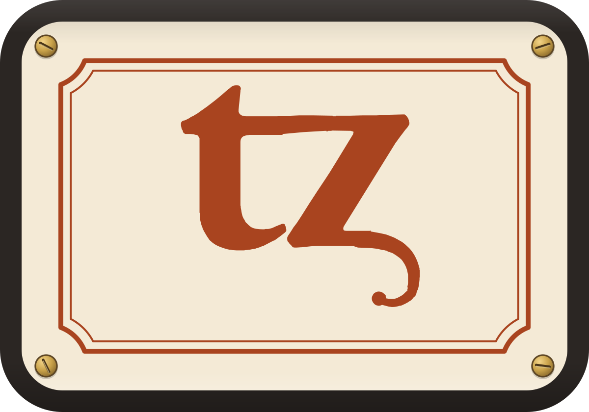
</p>

<h1 align="center">Nachtzug</h1>

<p align="center">
  A little music machine for acid and Berlin School music.<br>
  Every note is in the song’s scale, so you can make music without being able to play the keyboard.
</p>

<p align="center">
  <a href="https://github.com/mjohanning99/nachtzug/releases/latest"><b>Download</b></a> ·
  <a href="https://mjohanning99.github.io/nachtzug/">Website</a> ·
  <a href="docs/Nachtzug-Manual.pdf">Manual</a> ·
  <a href="docs/Nachtzug-Handbuch.pdf" hreflang="de">Handbuch</a>
</p>

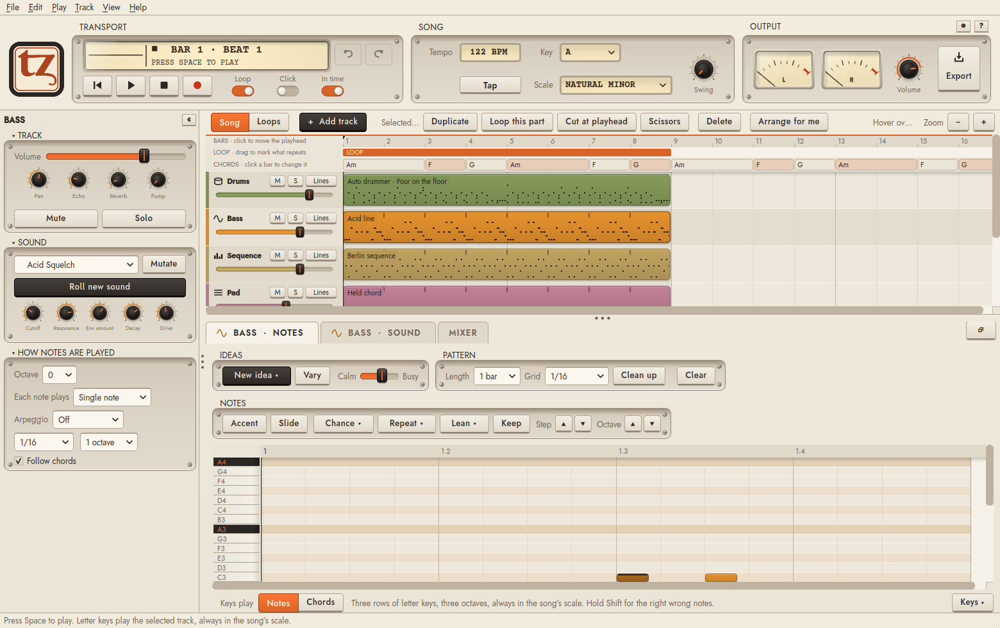

Nachtzug was built for a simple reason: making music more accessible. I fondly remember my parents getting me a music making program back in the late 2000s that I spent a lot of time with. It was very simple to use, didn’t require you to know any sort of music theory and I was able to make dozens of songs.

My mum wanted me to make a long electronic song that she could listen to on her way to work and so I ended up making a thirty-minute song and recorded it onto a free cassette (as her car had a cassette player and no CD player).

This program is supposed to emulate this but in a more modern setting. It includes various features that should appeal to both those who are still beginners and those who are more advanced. It is not a fully-featured DAW but a great way, in my opinion, for beginners to start making music!

Nachtzug is made for the kind of music that’s built from repeating synthesiser patterns: squelchy acid basslines, rolling Berlin School sequences, slow pads and simple melodies on top, all carried along by a drummer who never gets tired. It only lets you place notes that fit the song, it comes up with ideas when you’re stuck, and every change you make while the music plays waits politely for the next bar, so it always lands in time. Every change can be undone, too, and Nachtzug quietly keeps a spare copy of your song in case something goes wrong.

> [!NOTE]
> Nachtzug is still a work in progress and bugs are to be expected. If you find one, I’d be grateful if you [told me about it](https://github.com/mjohanning99/nachtzug/issues).

## What’s in it

- **Play along on your computer keyboard.** Three rows of letter keys play three octaves, and every key fits the song. A MIDI keyboard works too.
- **Ideas at the press of a button.** Acid lines, Berlin School sequences, chords, melodies and beats, with **Vary** to change just a note or two and **Clean up** to tidy what you played in.
- **An auto drummer** with seven styles. Pick one and how hard it plays; it adds the fills by itself.
- **A real synthesiser on every track**, with live pictures of what each knob does, and a **Simple** page with eight big knobs in plain words if you’d rather not see them all.
- **Sounds that move.** Draw a line for any knob, or record your knob turns while the song plays.
- **From a loop to a song.** Arrange clips on a timeline, jam with the loop grid, or press **Arrange for me** and get an intro, a build-up, a break and an ending.
- **Your own sounds.** A library of 65 sounds made for Nachtzug (nine of them from a night train!), your own samples, or a drum loop chopped across the pads.
- **Learn as you go.** Five short lessons walk you through the real program, one step at a time, and almost everything explains itself when you rest the mouse on it.
- **Share it.** Export your song as a WAV file, as one file per track, or as MIDI for other music programs.
- **In English and German**, with six colour themes and a printed operation manual in both languages.

| | |
|---|---|
| 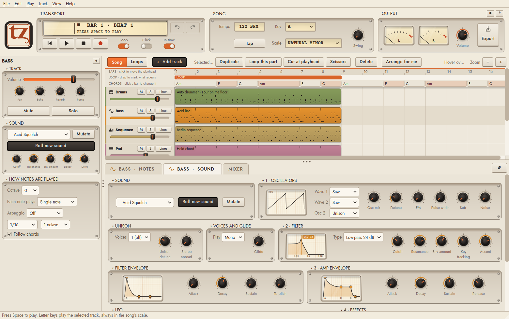 | 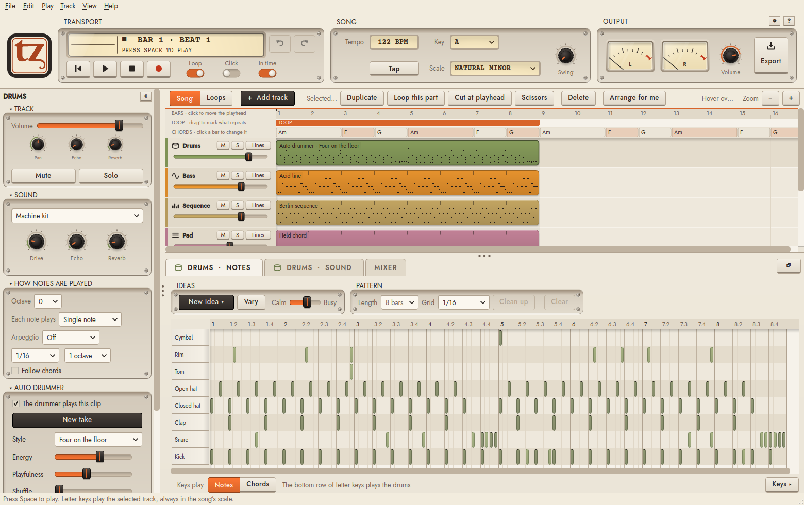 |
| **The synthesiser**, laid out in the order the sound flows. | **The auto drummer** writes the beat for you. |
| 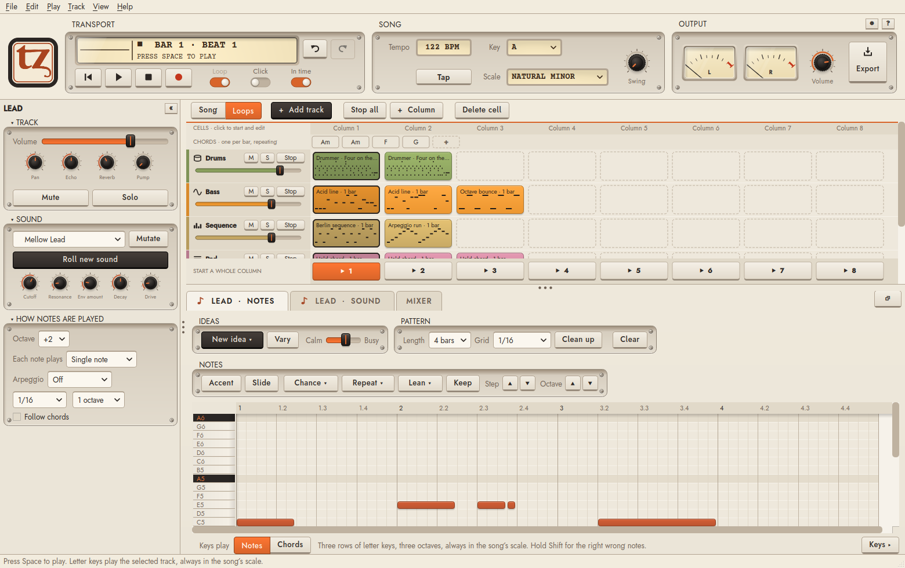 | 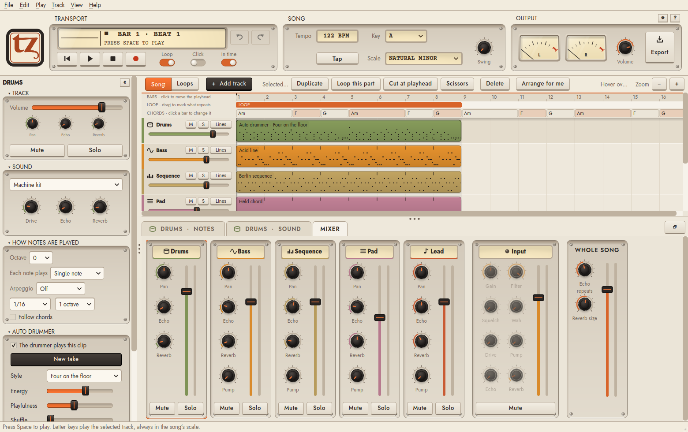 |
| **The loop grid**, for jamming like a live set. | **The mixer**, for balancing the tracks. |
| 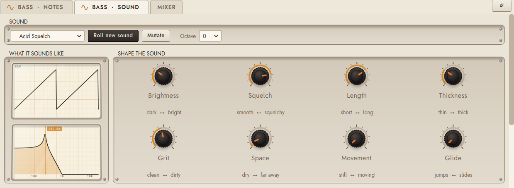 | 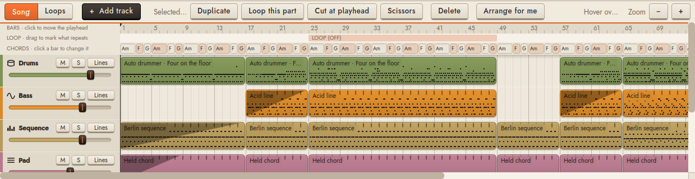 |
| **Simple**: eight big knobs in plain words. | **Arrange for me** turns your patterns into a song. |
| 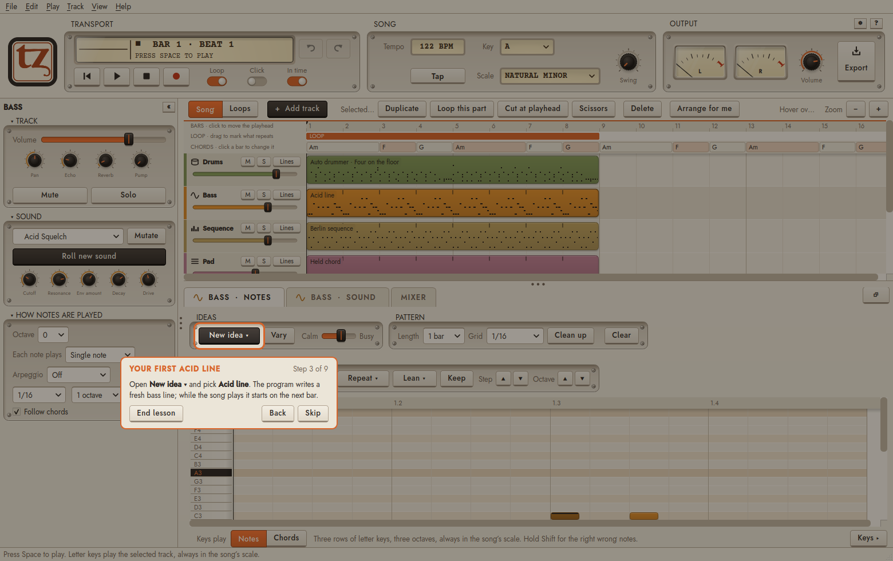 | 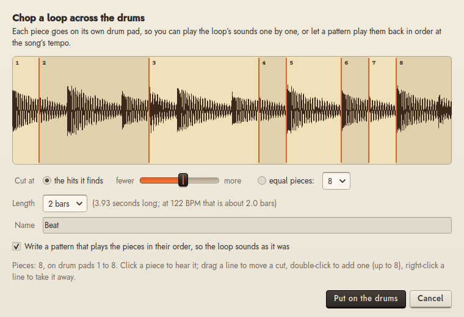 |
| **Lessons** show you one thing at a time. | **Chop a loop** across the drum pads. |
| 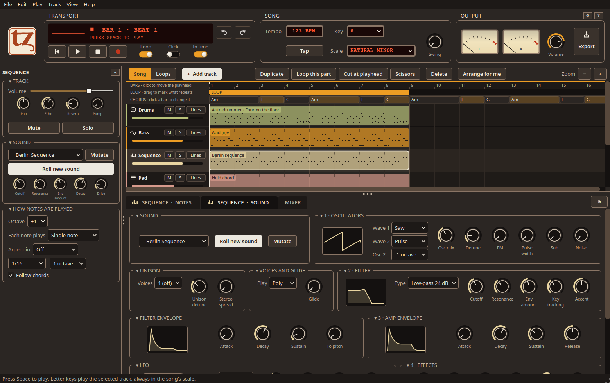 | 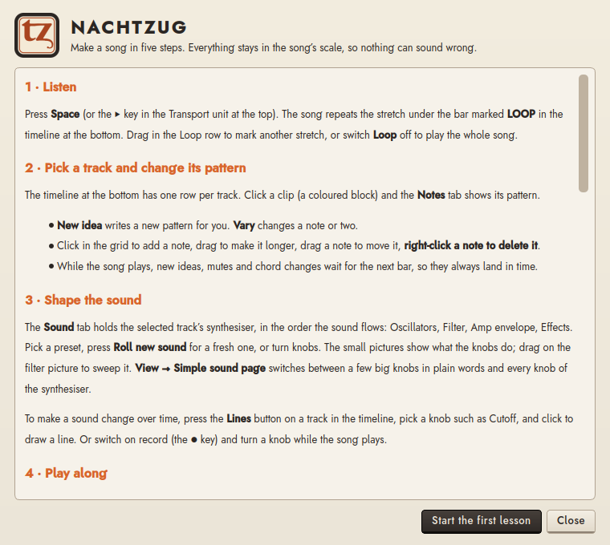 |
| **Ember**, one of six colour themes. | **The guide**, always one key away (F1). |

## Getting Nachtzug

### Linux: the AppImage

The quickest way: one file that runs on distributions from 2025 on, with nothing to install.

1. Download `Nachtzug-x86_64.AppImage` from the [latest release](https://github.com/mjohanning99/nachtzug/releases/latest).
2. Make it runnable: `chmod +x Nachtzug-x86_64.AppImage`, or tick “Allow executing as program” in its properties.
3. Double-click it.

### Linux: building it yourself

Don’t let building put you off: it’s a handful of commands, and you only have to do it once. It takes about ten minutes, most of it waiting.

1. **Install the tools.** Open a terminal and type the line for your system:

   | System | Command |
   |---|---|
   | Arch, CachyOS, Manjaro | `sudo pacman -S --needed base-devel cmake qt6-base qt6-tools sdl2 alsa-lib git` |
   | Debian, Ubuntu | `sudo apt install build-essential cmake qt6-base-dev qt6-tools-dev qt6-l10n-tools libsdl2-dev libasound2-dev git` |
   | Fedora | `sudo dnf install gcc-c++ cmake qt6-qtbase-devel qt6-qttools-devel SDL2-devel alsa-lib-devel git` |

2. **Download and build Nachtzug:**

   ```sh
   git clone https://github.com/mjohanning99/nachtzug.git
   cd nachtzug
   cmake -B build -DCMAKE_BUILD_TYPE=Release
   cmake --build build -j
   ```

3. **Start it** with `./build/nachtzug`. You should see the Nachtzug window, asking which language you’d like and how you’d like to begin.

A few extras, if you’d like them:

- To find Nachtzug in your application menu, with its icon: `sudo cmake --install build`.
- To use a MIDI keyboard, your user has to be in the `audio` group: `sudo usermod -aG audio $USER`, then log out and back in.
- To update later, run `git pull` in the `nachtzug` folder and then the `cmake --build build -j` line again.

### macOS

It takes about fifteen minutes.

1. Open the Terminal app and install Apple’s command line tools: `xcode-select --install`.
2. Install [Homebrew](https://brew.sh) by following the instructions on its website.
3. Download Nachtzug and run the build script:

   ```sh
   git clone https://github.com/mjohanning99/nachtzug.git
   cd nachtzug
   tools/build-macos.sh
   ```

   The script installs everything else it needs, builds the app, checks that it works and packs it into a disk image. It goes quiet for a minute or two while it copies Qt into the app, so please let it finish!

When it says `Done: build-macos/Nachtzug.app and build-macos/Nachtzug.dmg`, open the `.dmg` and drag Nachtzug into your Applications folder. The first time you open it, right-click Nachtzug, choose **Open** and then **Open** again (the app is only signed for your own Mac, not by a registered Apple developer). On a Mac, the **⌘** key does what **Ctrl** does elsewhere.

### Windows

Windows support is ready but hasn’t been tried on a real Windows computer yet. If you’d like to be the first: install [MSYS2](https://www.msys2.org), open the **MSYS2 UCRT64** terminal from the Start menu and, in the `nachtzug` folder, run `tools/build-windows.sh`. It builds Nachtzug and makes an installer.

## Your first five minutes

1. Press **Space**. A demo song starts to play.
2. Click the orange **Bass** clip in the timeline, press **New idea** and pick **Acid line**.
3. In the inspector on the left, press **Roll new sound** a few times, then turn **Cutoff** while it plays.
4. Play along on the letter keys: the row **A** to **;** is the middle octave.
5. Press **Arrange for me** above the timeline, then **Export** at the top right.

That’s your first song! If you’d like a guided tour instead, choose **Help → Lessons**.

## Learning more

| | |
|---|---|
| **The operation manual** | A printable A5 booklet, made like the manual of an old synthesiser, with pictures, sound recipes and patch sheets: [English](docs/Nachtzug-Manual.pdf), [Deutsch](docs/Nachtzug-Handbuch.pdf) |
| **The user guide** | [A first song, step by step](docs/USER_GUIDE.md) |
| **Inside the program** | **F1** (or the **?** at the top right) opens a short guide, **Help → Lessons** has five guided tours, and almost every button and knob explains itself when you rest the mouse on it |
| **What’s new** | [`CHANGELOG.md`](CHANGELOG.md) |

## Licence

Nachtzug is free: use it, share it and change it. **The music you make with it is yours, completely**, and so are the built-in sounds once they’re in your song.

- The program is under the [GNU GPL, version 3 or later](LICENSE).
- The sample library and the example songs are in the public domain ([CC0](LICENSES/CC0-1.0.txt)).
- The manuals and pictures are under [CC BY-SA 4.0](LICENSES/CC-BY-SA-4.0.txt), and the fonts under the SIL Open Font License.

[`LICENSING.md`](LICENSING.md) explains it all in plain words, and [`docs/THIRD-PARTY.md`](docs/THIRD-PARTY.md) lists the free software Nachtzug is built on.

## For developers

<details>
<summary>What you need, command-line options, project layout and limits</summary>

### What you need

A C++20 compiler (GCC 12 or newer, or a recent Clang), CMake 3.20 or newer, Qt 6 (Widgets, plus the Linguist tools for the translations), SDL2 and, on Linux, the ALSA library for MIDI. Sound goes out through SDL2, which works with PipeWire, PulseAudio, ALSA and JACK (and Core Audio on a Mac).

### Command-line options

| Command | What it does |
|---|---|
| `nachtzug song.nachtzug` | Opens a song. |
| `nachtzug --render out.wav [song.nachtzug]` | Writes a song (or the demo song) to a WAV file without opening a window. Add `--arrange 0\|1\|2` to arrange it first (short, medium, long). |
| `nachtzug --selftest` | Drives the program through its features without a window and reports problems. Exits with 1 if anything failed. |
| `nachtzug --guitest` | Clicks through the window’s own controls and reports problems. |
| `nachtzug --screenshot out.png [--tab 0\|1\|2] [--track N] [--theme NAME] [--loops] [--lines] [--guide] [--simple] [--arrange 0\|1\|2] [--chord-keys] [--lesson ID:STEP] [--size WxH] [--dialog NAME] [--geometry out.json]` | Saves a picture of the window (or of a dialog: `welcome`, `settings`, `soundcard`, `samples`, `midi`, `export`, `arrange`, `chop`) and quits. Test runs keep their own settings and sample folder. |
| `nachtzug --check-tooltips` | Lists every visible control that has no tooltip. |
| `--lang de` | Uses a language for this run (with any of the options above). |

### Project layout

| Where | What’s in it |
|---|---|
| `src/dsp.h` | Sound generation: oscillators, ladder filter, envelopes, synth voices, drum machine, echo, reverb, limiter. |
| `src/model.*` | The song: tracks, clips, notes, scales, chords, presets, the pattern generators and the auto drummer, saving and loading. |
| `src/engine.*` | The audio engine: plays the song in time, runs the synths and effects, renders WAV files. |
| `src/app.*` | Editing commands, named undo steps, clipboard, recording, the loop grid’s launching, the sound card. |
| `src/mainwindow.*` | The window, menus, top bar, the panels and the How to guide. |
| `src/inspector.*` | The inspector on the left. |
| `src/editor.*`, `src/soundpanel.*`, `src/mixer.*` | The Notes, Sound and Mixer tabs. |
| `src/timeline.*`, `src/loops.*` | The song timeline and the loop grid. |
| `src/widgets.*` | Colour themes, the screwed wells, folding sections, knobs, switches, meters, the display. |
| `src/samples.*`, `src/chopdialog.*` | Samples: the library, WAV and AIFF reading, importing, recording, chopping a loop. |
| `src/midiio.*`, `src/midi.*`, `src/midifile.*` | MIDI on each system’s own service, learned knobs, clock, and the MIDI file export. |
| `src/lessons.*`, `src/autosave.*` | The guided lessons; the spare copy of unsaved work. |
| `src/exportdialog.*`, `src/settingsdialog.*`, `src/welcome.*` | The export window, the settings and the first-start window. |
| `tools/samplegen/`, `assets/samples/` | The program that synthesises the sample library, and the library it wrote. |
| `tools/fonts/`, `assets/fonts/nachtzug/` | The scripts that build the Nachtzug type family (Antiqua, Initialen, Ornamente, Grotesk), and the fonts. |
| `tools/logo/`, `assets/logo/` | The enamel-sign logo and the scripts that draw it, make the icons and the picture for shared links. |
| `tools/build-appimage.sh`, `tools/build-macos.sh`, `tools/build-windows.sh` | Packing the program for Linux, macOS and Windows. |
| `tools/readme_shots.py`, `tools/site_shots.py` | The screenshots for this README and for the website. |
| `site/` | The website, built with Jekyll (see `site/README.md`). |
| `i18n/` | Translations. After changing texts in the code, run `cmake --build build --target update_translations` and translate the new entries in `nachtzug_de.ts`. |
| `docs/manual/` | The PDF manuals: `build.py` (English) and `build.py de` (German) turn the HTML into PDFs with WeasyPrint; `shots.py [en\|de]` takes their pictures. |

Songs are saved as `.nachtzug` files, which are plain JSON. Settings live in `~/.config/Nachtzug/Nachtzug.conf` and your samples in `~/.local/share/Nachtzug/Nachtzug/samples` (on a Mac in `~/Library/Application Support/Nachtzug/Nachtzug/samples`).

### Limits

- Built and tested on Linux; the Mac build works on Apple Silicon. Windows is set up but untested.
- MIDI on macOS and Windows hasn’t been tried with real devices yet.
- 4/4 time only, up to 12 tracks.
- No audio tracks: samples play on the drum machine’s eight drums, and the live input is heard but not recorded into the song.
- Samples must be WAV or AIFF (up to a minute); MP3, FLAC and OGG need converting first.

</details>
