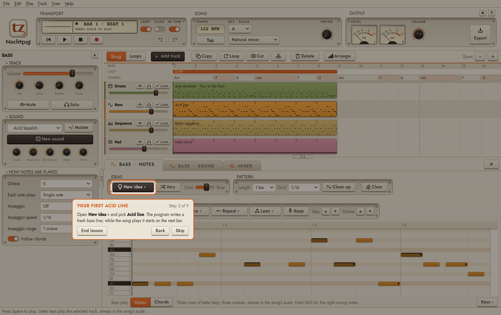
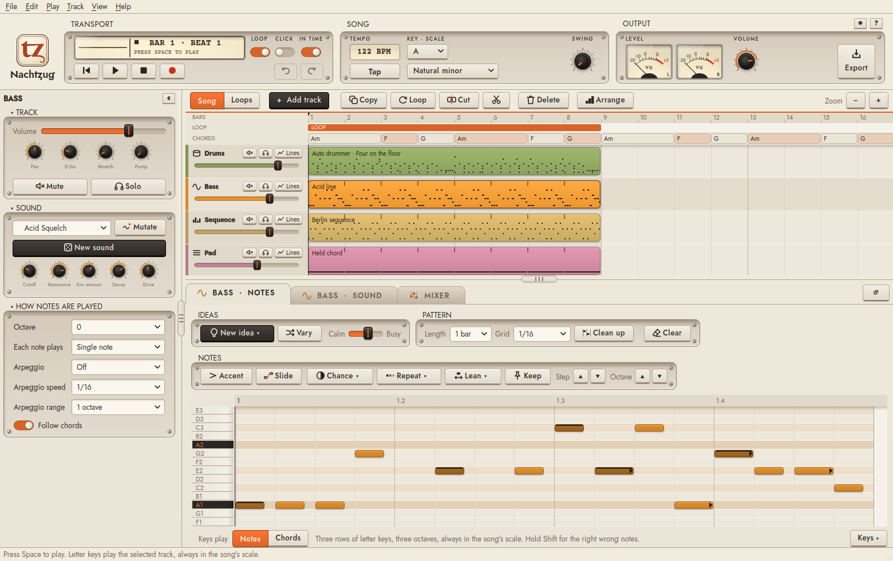
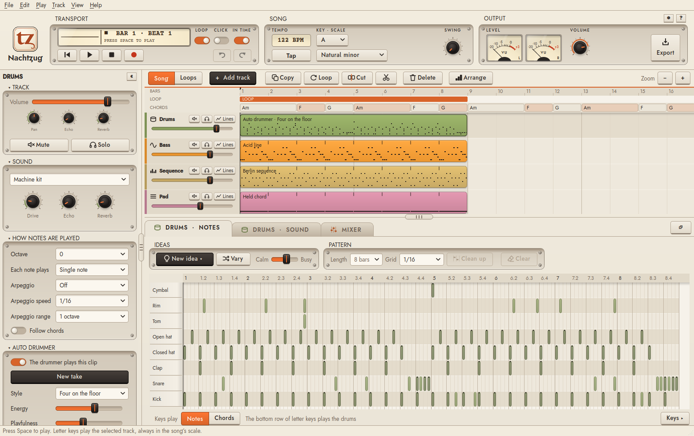
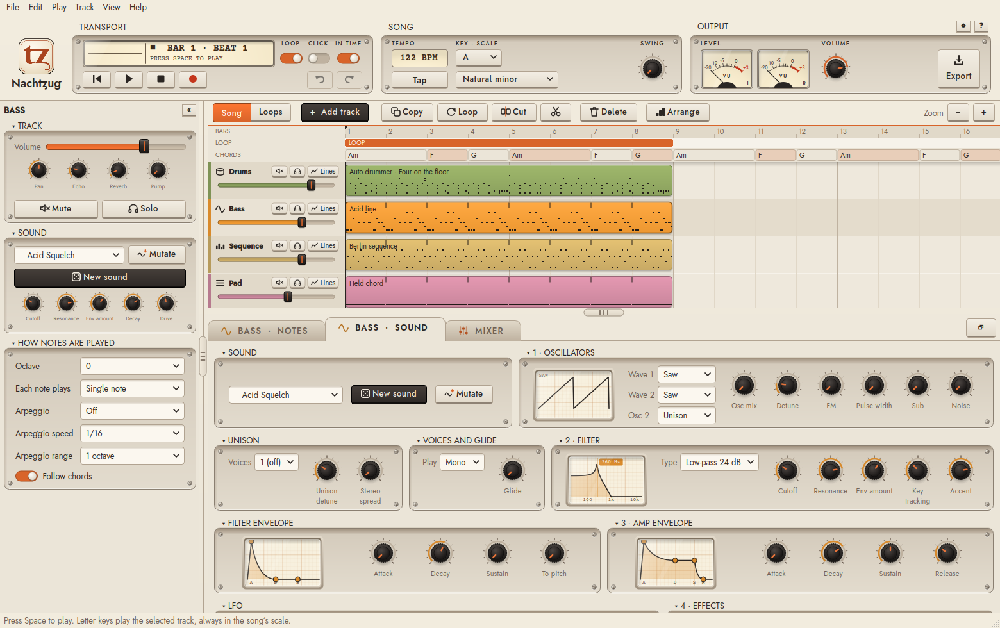
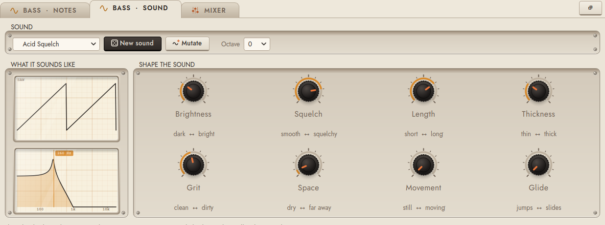
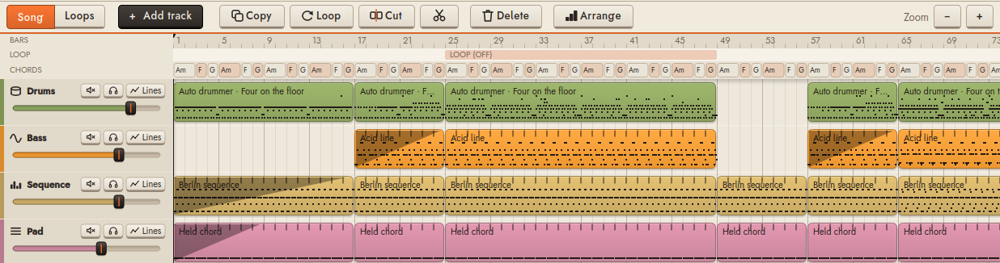
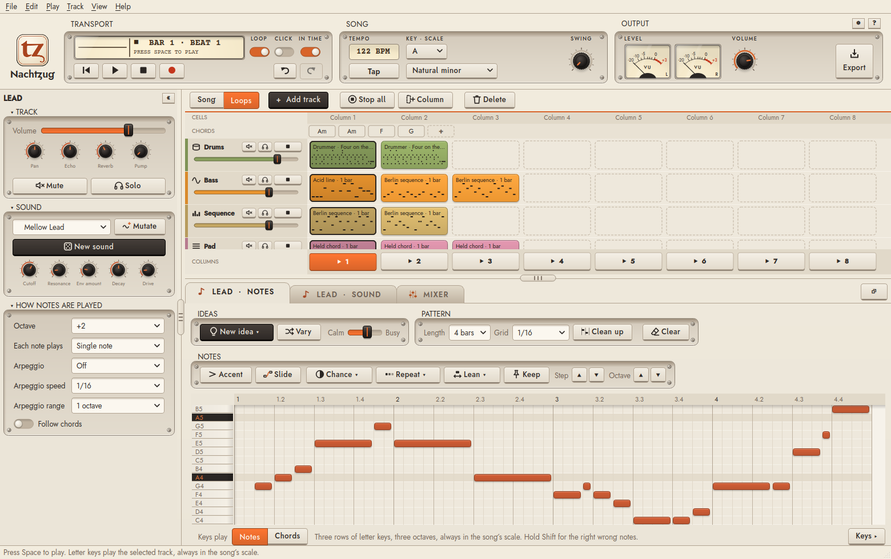
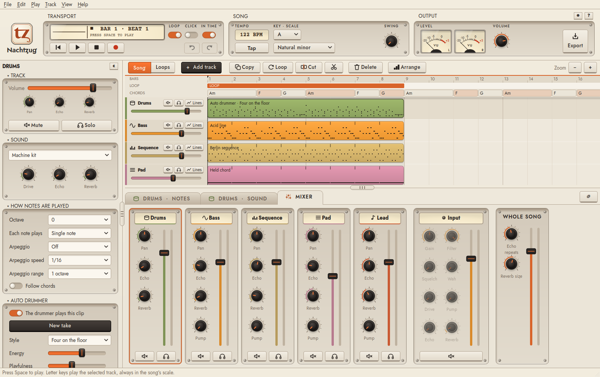
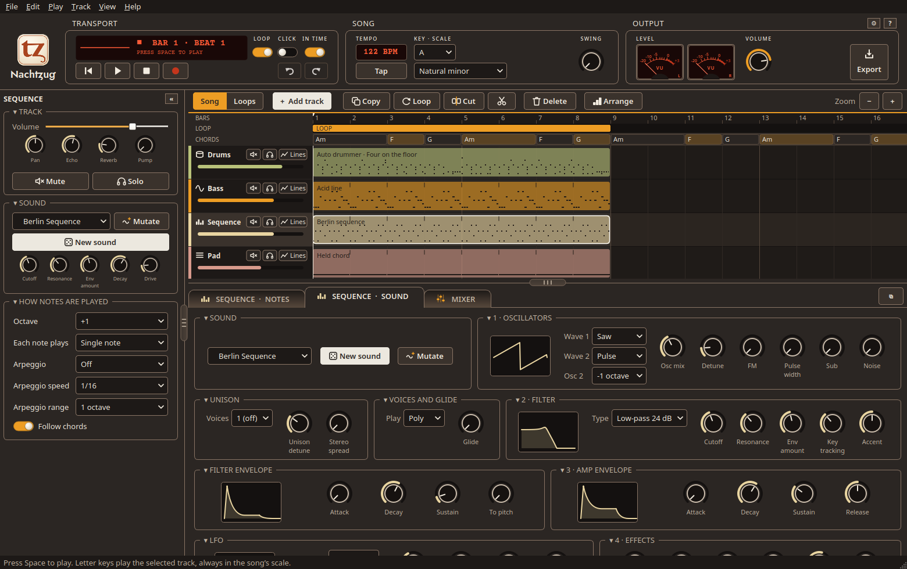

# Nachtzug user guide

This guide starts with making a first song in a few minutes, then explains each part of the window in turn. You don’t need to know any music theory or be able to play an instrument.

**Contents**

1. [Your first song](#1-your-first-song)
2. [The window at a glance](#2-the-window-at-a-glance)
3. [The top bar](#3-the-top-bar)
4. [Tracks](#4-tracks)
5. [Patterns: the Notes tab](#5-patterns-the-notes-tab)
6. [The auto drummer](#6-the-auto-drummer)
7. [Playing along and recording](#7-playing-along-and-recording)
8. [Shaping a sound: the Sound tab](#8-shaping-a-sound-the-sound-tab)
9. [Making sounds change over time](#9-making-sounds-change-over-time)
10. [The song timeline](#10-the-song-timeline)
11. [Chords](#11-chords)
12. [The loop grid](#12-the-loop-grid)
13. [The mixer](#13-the-mixer)
14. [Saving and exporting](#14-saving-and-exporting)
15. [Settings, sound card and your own samples](#15-settings-sound-card-and-your-own-samples)
16. [MIDI keyboards, controllers and clock](#16-midi-keyboards-controllers-and-clock)
17. [Keyboard shortcuts](#17-keyboard-shortcuts)
18. [Troubleshooting](#18-troubleshooting)

---

## 1. Your first song

The very first time, Nachtzug asks which language you want and how you would like to start. **I am new to this** gives the Sound tab a few big knobs in plain words and opens a short guide; **I know synthesisers** shows every knob. Both can be changed later.

1. **Listen.** Start Nachtzug and press **Space** (or the **▶** key at the top left). A demo song plays: drums, a bass line, a repeating sequence, a pad and an empty lead track.
2. **Get a new bass line.** In the timeline, click the orange **Bass** clip. The **Notes** tab now shows its pattern. Press **New idea** and pick **Acid line**. The new pattern starts on the next bar. Press **Vary** a few times to change a note or two each time.
3. **Change its sound.** Click the **Sound** tab and press **New sound** (the die) until you hear one you like. On the Simple page, turn **Brightness** and **Squelch**; on the Full page, **Cutoff** and **Resonance** do the same.
4. **Add a melody.** Click the **Lead** track’s name in the timeline, go back to the **Notes** tab, press **New idea** and pick **Melody**.
5. **Make it a song.** Press **Arrange** above the timeline and pick **Medium**: your patterns become an intro, a build-up, a main part, a break and an ending. (Or drag the right edge of each clip yourself; a pattern repeats for as long as its clip lasts.)
6. **Keep it.** Press **Ctrl+S** to save. For a sound file, press **Export** at the top right; when it is done, **Play it** opens it in your music player.

Don’t like a change? The **↶** key beside the display takes it back, as often as you like.

Want a different starting point? **File → New song with fresh ideas** (Ctrl+N) makes a new song with drums, bass, sequence and pad already written and a random chord progression.

**Lessons.** For a guided start, open **Help → Lessons**. Five short lessons (your first acid line, building a beat, recording a filter sweep, playing the chords Berlin School style, and turning a loop into a song) dim the window, light up the one control to use next and wait until you have tried it. **Skip** goes on without a step, **End lesson** stops. The guide (F1) has a **Start the first lesson** button.

---

## 2. The window at a glance

From top to bottom:

- **The top bar** has three units, like the front of a hardware machine: **Transport** (the display, undo and redo, and the play keys), **Song** (tempo, key, scale and swing) and **Output** (level meters, volume, the Export key, settings and the guide).
- **The tabs** show the selected track. The tab names say which track that is, for example **BASS · NOTES** and **BASS · SOUND**. The third tab, **MIXER**, shows every track at once.
- **The bottom area** holds the arrangement. Switch it between **Song** (the timeline) and **Loops** (the loop grid) with the two buttons on its left.

Hovering over almost any button, knob or part of the timeline shows a short explanation, both as a tooltip and in the status line at the very bottom.

**Which part do Delete and copy act on?** The note editor and the timeline both react to Delete, Ctrl+C, Ctrl+V and Ctrl+D. The one you clicked last has a thin coloured line along its top edge.

---

## 3. The top bar

### Transport

| Control | What it does |
|---|---|
| **Display** | Shows the bar and beat, which track the letter keys play, and short messages such as *Change lands on the next bar*. The small wave on the left is what you hear. |
| **⏮** | Back to the start of the loop, or of the song when Loop is off. Same as Home. |
| **▶** | Play. Space starts and stops. |
| **■** | Stop. |
| **●** | Record. While it is lit and the song plays, notes you play and knobs you turn are written into the song. See [section 7](#7-playing-along-and-recording). |
| **Loop** switch | Repeats the stretch marked in the timeline’s Loop row. Switch it off to play the whole song. |
| **Click** switch | A metronome tick on every beat, with a higher tick at the start of each bar. |
| **In time** switch | Pulls notes you play by hand onto the beat while the song plays. |
| **↶ ↷** | Undo and redo, beside the display (Ctrl+Z, Ctrl+Shift+Z). Hover over them to see what they would take back, for example *Undo: New idea*. After a big change, a note at the bottom of the window offers **Undo** too. |

### Song

| Control | What it does |
|---|---|
| **Tempo** | Speed in beats per minute. Click it and type a number, or turn the mouse wheel over it. |
| **Tap** | Tap along with a beat, four times or more, and the tempo follows. |
| **Key** and **Scale** | The notes the whole song uses. Every pattern is fitted to them, so changing the key moves the whole song. While the song plays, the change lands on the next bar. |
| **Swing** | Delays every second sixteenth note a little, for a rolling feel. |

### Output

| Control | What it does |
|---|---|
| **Meters** | How loud the left and right channels are. The needle reaching the red mark means the output limiter is working. |
| **Volume** | Volume of everything you hear. |
| **Export** | Saves the song as a sound file ([section 14](#14-saving-and-exporting)). Ctrl+Shift+E. |
| **⚙** | Opens the settings ([section 15](#15-settings-sound-card-and-your-own-samples)). |
| **?** | Opens the short guide. Same as F1. |

The scales are Natural minor, Dorian, Phrygian, Harmonic minor, Phrygian dominant, Minor pentatonic, Major and Lydian. For dark acid and Berlin School music, Natural minor, Dorian and Phrygian are good places to start.

---

## 4. Tracks

Each track is one instrument: a synthesiser, or the drum machine. There are five kinds, and each comes with a fitting sound and a ready pattern:

| Kind | Typical use |
|---|---|
| **Bass** | Acid lines and low pulses. Plays one note at a time and can glide between notes. |
| **Sequence** | The repeating pattern at the heart of Berlin School music. |
| **Pad** | Long chords in the background. |
| **Lead** | A melody on top. |
| **Drums** | The drum machine, played by the auto drummer or by hand. |

- **Add a track:** press **+ Add track** above the timeline, or use the **Track** menu. A song can have up to 12 tracks.
- **Select a track:** click its name in the timeline, the loop grid or the mixer. The letter keys then play it and the tabs show it.
- **Rename, duplicate, reorder or delete:** right-click the track’s name. Double-click the name to rename it straight away.
- **M** mutes a track and **S** (solo) lets you hear only that track. While the song plays, both switch on the next bar.
- The coloured bar under the name is the track’s **volume**; drag it left or right. The thin line under that shows how loud the track is right now.

---

## 5. Patterns: the Notes tab

A **clip** is a coloured block in the timeline. It holds a **pattern** of notes that repeats for as long as the clip lasts. Click a clip and the **Notes** tab shows its pattern.

### Getting ideas

- **New idea** writes a new pattern for the clip. The choices depend on the kind of track: for example **Acid line**, **Octave bounce**, **Root pulse** and **Berlin sequence** for a bass, or **Held chord** and **Chord stabs** for a pad.
- The **Calm – Busy** slider sets how many notes new ideas have.
- **Vary** changes a note or two. Press it a few times for more change.

While the song plays, a new idea or variation starts on the next bar, so it always lands in time.

### Pattern settings

- **Length** is how long the pattern is before it repeats: half a bar up to eight bars.
- **Grid** is the size of the steps that notes snap to, from quarter notes down to thirty-second notes, including triplets.
- **Clear** removes every note in the pattern.

### Editing notes

Every row in the grid is a note of the song’s scale; the darker rows are the key note (for example every A in A minor). Click a note name on the left to hear it. On tracks that follow the chords, the rows of the current chord’s notes are **tinted**: they are the safest choices and always fit.

An empty pattern says what to do in the grid itself. Hovering over a note tells you its name and whether it is accented or slides.

Under the grid are three rows of **on-screen keys** (**Low**, **Middle**, **High**). Each shows the letter key that plays it and the note it plays; you can click them too. **View → On-screen keys under the notes** hides them.

| To do this | Do this |
|---|---|
| Add a note | Click an empty spot. Keep the button down and drag right to make the note longer. |
| Move a note | Drag it. Up and down changes the pitch, left and right the timing. |
| Make a note longer or shorter | Drag its right edge. |
| Delete a note | Right-click it. Keep the right button down and sweep over notes to delete several. |
| Select several notes | Hold **Shift** and drag a box around them. **Ctrl+click** adds or removes single notes. |
| Zoom | **Ctrl** + mouse wheel. |

The buttons in the **Notes** group act on the selected notes; **Step** and **Octave** move every note when none is selected:

- **Accent** makes notes louder and brighter. Accented notes are drawn in a deeper colour with a line along their top.
- **Slide** makes a note glide into the next one, the typical acid bassline effect. Sliding notes have a small arrow at their end. Slides work best on sounds set to play one note at a time (**Mono**).
- **Step ▲ / ▼** moves notes one scale note up or down.
- **Octave ▲ / ▼** moves notes a whole octave.

Three more work on selected notes only (on a drum track, select hits with **Shift** + drag or **Ctrl+click**, because a plain click removes a hit):

- **Chance ▾:** how often a note plays: always, often (3 times in 4), half the time, or now and then (1 time in 4). Every pass through the loop decides again, so a short pattern keeps changing. Try it on a few hi-hats. Such notes look faded, with a dashed edge and their percentage.
- **Repeat ▾:** plays a note two, three or four times in quick succession over its length, for drum rolls and acid stutters. A note with a chance plays all its repeats or none.
- **Keep:** **Vary** and **New idea** leave kept notes alone and write around them. Kept notes show a small padlock. Press again to let them go.

---

## 6. The auto drummer

Drum clips start with the auto drummer switched on: the program writes the drum hits from a few settings, and keeps writing them when you change a setting. The panel to the left of the drum grid holds the settings.

| Setting | What it does |
|---|---|
| **The drummer plays this clip** | Switch it off to place hits yourself. The hits the drummer wrote stay, so you can start from them. |
| **Style** | Four on the floor, Acid house, Motorik, Broken beat, Half time, Electro or Berlin pulse. |
| **Energy** | How hard the drummer plays: from a bare pulse up to full hi-hats, open hats and crashes. |
| **Playfulness** | How many ghost notes and small surprises are added. |
| **Shuffle** | Plays every second sixteenth a little late. |
| **Fills** | How often a drum fill comes: never, or every 2, 4 or 8 bars. A fill always comes at the end of the clip. |
| **Backbeat** | Which drum plays on beats 2 and 4: the style’s own choice, clap, snare, rim or none. |
| **Hi-hats** | What the hi-hats play: the style’s own pattern, eighths, sixteenths, offbeats only or none. |
| **Over the clip** | Steady, or **Build up** (start soft, end hard) or **Wind down**. Good for the start and end of a song. |
| **Crash after fills** | A cymbal crash on the first beat after each fill. |
| **New take** | Same settings, different playing. |

To place drum hits by hand, switch the drummer off, then click in the grid to add a hit and click a hit to remove it. The letter keys **Z** to **,** play the eight drums.

---

## 7. Playing along and recording

Your computer keyboard is the instrument. Three rows of letter keys play the selected track:

| Keys | Plays |
|---|---|
| **Q W E R T Y U I O P** | The highest octave |
| **A S D F G H J K L ;** | The middle octave; **A** is the key note |
| **Z X C V B N M , . /** | The lowest octave |

Every key is a note of the song’s scale, so any key you press fits. On a drum track the keys play the eight drums. The on-screen keys under the note grid show which letter plays which note, and light up as you play.

In the **Sound** tab, under **How notes are played**, you can change what one key does:

- **Each note plays:** a single note, octaves, fifths, a triad, a seventh chord, an open triad or stacked fourths. The chords are built from the scale, so they always fit.
- **Arpeggio:** plays held notes and chords one after another: up, down, up and down, random, or in the order you pressed them, at a chosen speed and over one to three octaves.

The **In time** switch (top bar) pulls what you play onto the beat while the song plays. A note played a little late sounds at once; a note played a little early waits for the beat.

**Chords mode.** Above the on-screen keys, switch **Keys play** from **Notes** to **Chords** (or press **Ctrl+J**). Each letter key is now a chord of the scale, and every track that follows the chords moves to it at once while its pattern keeps running, the way old synthesiser sequencers were transposed from their keyboards. The chord stays when you let go; **Esc** goes back to the song’s own chords. With record on, the chords are written into the chord row bar by bar. The pads name the chords; arrows mark the octave above or below.

A **MIDI keyboard** plays along like the letter keys ([section 16](#16-midi-keyboards-controllers-and-clock)).

**To record:** press the **●** key so it lights, press **▶**, then play the keys. The notes are written into the clip under the playhead; if there is no clip there, one is made. With **Play → Snap recorded notes to the grid** on (the default), recorded notes are lined up with the grid. Ctrl+Z takes back a recorded note.

---

## 8. Shaping a sound: the Sound tab

The Sound tab holds the selected track’s synthesiser. The sections are numbered in the order the sound flows: the oscillators make it, the filter shapes its tone, the amp envelope shapes its loudness, and the effects colour it.

### Simple or Full

The Sound tab has two pages: **View → Simple sound page** switches between them (the General page of the settings has the same choice). **Full** shows every knob, as described below. **Simple** shows eight big knobs in plain words, each moving several of the Full page’s knobs at once from wherever they are: **Brightness** (cutoff), **Squelch** (resonance, env amount and accent), **Length** (decay and release), **Thickness** (unison, sub and detune), **Grit** (drive), **Space** (reverb and echo), **Movement** (a slow filter wobble and chorus) and **Glide**. For a drum track the Simple page has a level knob per drum, its sample button, and Grit, Echo and Space for the whole kit.

**Knobs:** drag up or down. Hold **Shift** for small steps. Double-click to reset. Move the mouse over a knob to see its value and what it does. A small red dot on a knob means it has a line that changes it over time ([section 9](#9-making-sounds-change-over-time)).

### Finding a sound quickly

- **Sound** picks a ready-made preset, grouped by use. In the open list, rest the mouse on a preset to hear a short phrase with it in the song’s key and tempo; the list of drum kits does the same. The presets (bass, sequence, pad, lead, effects): Acid Squelch, Rubber Square, Deep Bass, Zap Bass, Berlin Sequence, Glass Pluck, Pulse Wanderer, Hollow Band, String Machine, Supersaw Pad, Phase Choir, Night Drone, Thin Air, Mellow Lead, Saw Lead, Wide Unison Lead, FM Bell and Sample and Hold.
- **New sound** (the die) builds a brand new sound that suits the kind of track.
- **Mutate** nudges every knob a little, for a close relative of the current sound.
- **Ctrl+Z** brings the previous sound back.

### The sections

| Section | What it does |
|---|---|
| **1 · Oscillators** | The raw sound. Two waveforms (saw, pulse, triangle, sine), the second one tuned an octave down, in unison, a fifth up or an octave up. **Osc mix** blends them, **Detune** makes them beat against each other, **FM** lets the second bend the first for bells and metallic tones, **Pulse width** thins out the pulse wave, **Sub** adds a deep tone an octave below, **Noise** adds hiss. The picture shows the waveform. |
| **Unison** | Stacks up to seven slightly detuned copies of the oscillators for a big, wide sound. **Stereo spread** spreads the notes across left and right. |
| **Voices and glide** | **Poly** plays chords; **Mono** plays one note at a time, as acid basslines do. **Glide** slides the pitch from one note to the next. |
| **2 · Filter** | Takes away part of the sound. **Type**: low-pass (24 or 12 dB, the classic dark-to-bright sweep), band-pass (thin and nasal) or high-pass (removes the low end). **Cutoff** is where it cuts, **Resonance** adds the squelchy peak, **Env amount** lets each note open the filter, **Key tracking** makes high notes brighter, **Accent** sets how much accented notes stand out. The picture shows which pitches get through, with the cutoff marked in Hz; **drag on it** to set cutoff and resonance together. |
| **Filter envelope** | How the filter opens and closes on each note: **Attack**, **Decay**, **Sustain**. **To pitch** also bends the pitch, for zaps and laser sounds. Drag the round points in the picture to shape it directly. |
| **3 · Amp envelope** | How loud each note is over time: a short **Attack** and **Decay** for plucks, long ones for pads. **Release** is how long a note rings after it ends. The points in the picture can be dragged too. |
| **LFO** | A slow, repeating movement: triangle, square or random steps. The dot in the picture moves at the LFO’s speed. Send it to the filter (**LFO to filter**), the pitch (**Vibrato**) or the pulse width (**LFO to width**). |
| **4 · Effects** | **Drive** (distortion), **Phaser**, **Chorus**, and how much goes to the shared **Echo** and **Reverb**. |
| **Shared echo and reverb** | One echo and one reverb for the whole song. **Echo time** follows the tempo; **Echo repeats**, **Reverb size** and **Reverb damping** set their character. Each track’s Echo and Reverb knobs set how much of it goes in. |

For a **drum track** the Sound tab shows the drum kit instead: a kit preset (Machine kit, Soft boom kit, Tight acid kit), and **Level**, **Tune** and **Decay** for each of the eight drums, with a **▶** button to hear each one. The button under it says **Built-in**: click it to let that drum play one of your own samples instead ([section 15](#15-settings-sound-card-and-your-own-samples)). With a sample, **Tune** plays it faster or slower (up to an octave either way) and **Decay** shortens it.

---

## 9. Making sounds change over time

A filter that slowly opens over sixteen bars, or a cutoff that wobbles every bar, makes a repeating pattern come alive. Nachtzug can do this for any knob, in two ways.

### Drawing a line

1. In the timeline, press the **Lines** button on the track. A lane opens under the track.
2. Click **Line: …** on the left of the lane and pick the knob, for example **Cutoff**.
3. Click in the lane to add points. Drag points to move them; right-click a point to remove it. Hold **Shift** while dragging for fine steps. The sound follows the line as the song plays.
4. Click **Follows the song** to choose how the line repeats: one long line over the whole song, or a short shape that repeats every half bar, bar, or 2, 4 or 8 bars.

You can also right-click any knob in the Sound tab and choose **Draw a line for … in the timeline**.

### Recording knob moves

Press **●** so it lights, press **▶**, and turn a knob. The movement is written as a line. Every line also shows as a thin red curve over the track’s clips in the timeline.

A knob on a MIDI controller records the same way once it has learned its knob on screen ([section 16](#16-midi-keyboards-controllers-and-clock)).

**Setting a knob by hand pauses its line,** so you can try something out. The **Resume lines** button in the Sound tab brings the lines back. To delete a line, right-click the knob and choose **Erase the line**, or use **Erase this line** in the lane’s knob menu.

---

## 10. The song timeline

The timeline is the bottom area in **Song** mode. Time runs from left to right, measured in bars, with one row per track.

### The three rows at the top

- **Bars:** click or drag here to move the playhead.
- **Loop:** the coloured bar marks the stretch that repeats while **Loop** is on. Drag in this row to mark another stretch; click it to switch looping on or off. **Loop** above the timeline puts the loop around the selected clips.
- **Chords:** the chord of each bar ([section 11](#11-chords)).

### Working with clips

| To do this | Do this |
|---|---|
| Make a new clip | Double-click an empty spot in a track’s row. |
| Select a clip | Click it. **Ctrl+click** adds more clips to the selection. |
| Edit its notes | Double-click it. |
| Move it | Drag it. A single clip can also be dragged onto another track of the same kind (a synth clip onto a synth track, a drum clip onto a drum track). |
| Make it longer | Drag its right edge. The pattern repeats; small ticks along the top show where. |
| Cut it in two | Turn on the scissors (✂) and click where to cut, or put the playhead there and press **Cut** (Ctrl+E). |
| Copy it | **Copy** (Ctrl+D) puts a copy right after it. Ctrl+C and Ctrl+V copy and paste at the playhead. |
| Delete it | **Delete**, or the Delete key. |
| Fade it in or out | Right-click it and choose **Transition at the start** or **at the end**: a fade, a filter sweep, or both, from one beat to four bars long. A dark wedge on the clip shows the transition. |

Moves snap to whole beats; hold **Shift** while dragging for sixteenth steps. **Ctrl** + mouse wheel, or the **− / +** buttons, zoom in and out. Ctrl+Z undoes any change.

### Arrange for me

**Arrange for me** (the **Arrange** key above the timeline, also in the Edit menu) turns your patterns into a whole song. It takes each track’s pattern at the loop and lays out:

| Part | What plays |
|---|---|
| **Intro** | A soft drummer; the pad fades in; the sequence fades in as its filter opens. |
| **Build-up** | The bass comes in with its filter opening; the drummer builds up. |
| **Main part** | Everything. |
| **Break** | No drums and no bass: pad, sequence and the lead. |
| **Main part 2** | Everything again, with the lead, a busier drummer and slightly varied patterns. |
| **Outro** | The drummer winds down; the parts fade out with their filters closing. |

Choose **Short**, **Medium** or **Long**; the window shows how long that is at the current tempo. An empty lead track gets a melody of its own. What was in the timeline is replaced, and **↶** brings it back. Afterwards everything is ordinary clips you can change.

---

## 11. Chords

Each bar of the song has a chord. Tracks set to **Follow chords** (bass, sequence and pad by default) move their notes along with it, so a single one-bar pattern plays over a whole progression.

- **Change a chord:** click the bar in the **Chords** row and pick a chord. Only chords built from the song’s scale are offered. The change applies to that bar only.
- **Repeat a short progression across the whole song:** in the same menu, choose **Repeat the first bars across the whole song**.
- **Surprise me with a new progression** writes a fresh one.

Whether a track follows the chords is set with **Follow chords** in its Sound tab, or by right-clicking its name. Leads and drums don’t follow by default.

---

## 12. The loop grid

Press **Loops** above the bottom area to swap the timeline for the loop grid. It is made for trying ideas and for playing live: every track has a row of **cells**, and each cell holds a pattern that repeats for as long as it is switched on.

- **Start a cell:** click it. It starts on the next bar and replaces whatever that track was playing. A cell waiting for the bar line blinks.
- **Stop a cell:** click it again. **Stop** on the track’s left stops that track, **Stop all** stops everything, both on the next bar.
- **Edit a cell:** clicking a cell also shows its pattern in the Notes tab; the cell you are editing has a ring around it. To change a playing cell’s notes without stopping it, **Shift+click** it.
- **Get a new idea:** click an empty cell. It fills with a fresh pattern and starts.
- **Start a whole column:** the **▶ 1**, **▶ 2** … buttons along the bottom start every cell in that column together. Tracks with no cell in that column stop.
- **Chords:** the **Chords** row above the cells shows the progression, one box per bar, repeating in order. The current bar is lit. Click a box to change its chord, **+** to add a bar, or choose **Remove this bar** from a box’s menu.
- **More:** right-click a cell to copy it into the next column, copy it into the song timeline at the playhead, or delete it. **+ Column** adds another column.

The first time you open the loop grid, each track’s first clip is placed in column 1 so there is something to start.

### Turning a jam into a song

Press **●** so it lights while you start and stop cells. Everything you launch is written into the song timeline as clips, from the bar it started to the bar it stopped. Press **Song** afterwards to see the result and edit it like any other part of the timeline.

---

## 13. The mixer

The **MIXER** tab shows one strip per track, side by side:

- **Pan**, **Echo**, **Reverb** and **Pump** knobs. **Pump** ducks the track on every kick drum and lets it swell back, the breathing sound of dance music; try it on a pad or a bass line (the drums have none: they drive it).
- A **volume fader**, with the track’s level meter beside it. The meter turns red when the track is very loud. Double-click the fader to reset it.
- **Mute** and **Solo** buttons.
- Click a track’s name to select it.

The **Input** strip plays the sound card’s input live through Nachtzug: a guitar, a voice, another synthesiser. Press **Input** to open it (choose the device on the Sound card page of the settings). **Gain** sets how loud it comes in, **Filter** and **Squelch** work like a synth filter, **Wah** opens the filter as you play louder, and **Drive**, **Pump**, **Echo** and **Reverb** work as on the tracks. With a microphone, use headphones, or the speakers feed back. The input is never part of an export.

The **Whole song** strip on the right holds the master volume and the shared echo repeats and reverb size.

Everything is protected by a limiter at the output, so the sound won’t crackle if the mix gets too loud, but it will be squashed. If the meters are red a lot, turn tracks down rather than up.

---

## 14. Saving and exporting

| Menu entry | Shortcut | What it does |
|---|---|---|
| File → New song with fresh ideas | Ctrl+N | A new song with drums, bass, sequence and pad, and a random chord progression. |
| File → New empty song | | A song with no tracks. |
| File → Open… | Ctrl+O | Opens a `.nachtzug` song. |
| File → Save / Save as… | Ctrl+S / Ctrl+Shift+S | Saves the song. |
| File → Export: sound file, tracks or MIDI… | Ctrl+Shift+E | The same as the **Export** key (below). |
| File → Settings… | Ctrl+, | [Section 15](#15-settings-sound-card-and-your-own-samples). |

Nachtzug asks before closing or opening another song if there are unsaved changes. The window title shows a `*` while there are. While there are, it also keeps a spare copy every half minute: if Nachtzug ever closes without asking (a crash, a power cut), the next start offers to bring the song back.

**Export** at the top right. Under **Make**, choose:

- **One sound file (WAV):** the whole song mixed.
- **A sound file for each track (stems):** every track that is heard in its own WAV file in a new folder (`01 Drums.wav`, `02 Bass.wav` …), all starting together and adding up exactly to the song, for mixing in another program.
- **A MIDI file with the notes:** the notes of every track for other music programs, with chords, arpeggios, repeats, swing and chances written out as you hear them; drums on General MIDI drum notes, channel 10.

Muted tracks are left out. Then choose:

- **What:** the whole song from bar 1 to the end of the last clip, or only the loop, played 1 to 32 times.
- **Ending:** let the echo and reverb ring out (the file ends once they have died away), or fade out over the last bars.
- **Quality:** CD quality (44.1 kHz, 16-bit) plays everywhere; 48 kHz suits video; 24-bit at 48 or 96 kHz is for further work in a studio program.
- **Save as:** the file name, in your Music folder to begin with.

When it is written, **Your song is ready** shows its length and size, with **Play it** and **Show in folder**. Songs can also be exported from a terminal: `nachtzug --render out.wav song.nachtzug`.

---

## 15. Settings, sound card and your own samples

The **⚙** key in the Output unit, or **File → Settings…** (Ctrl+,), opens the settings. Every change counts at once.

**General:** the language (from the next start), the colours, the **Size** of everything (Automatic picks the largest size that fits your screen; a new size counts from the next start, and **Start again now** restarts at once), whether the Sound tab opens on Simple or Full, **Keys** (a symbol and a word on each key, or the symbols alone with the word in the tooltip), **Window** (the timeline above the notes or beside them), the on-screen keys, the Undo note, **Show scroll bars** (without them, the wheel and the trackpad scroll as usual; Shift + wheel scrolls sideways), and whether to show the welcome window again.

**Sound card:** the **Sound system** (Automatic picks the best one; on Linux you can also choose PipeWire, PulseAudio, ALSA or JACK), **Play through** (which speakers or headphones), **Sample rate** and **Buffer**. A smaller buffer makes the letter keys answer faster; if the sound crackles, choose a larger one. **Play a test tone** checks that sound comes out. **Record from** picks the microphone or line input, for recording samples and for the mixer’s Input strip. If the chosen output is missing at the next start, Nachtzug falls back to the default and says so.

**Samples:** the Nachtzug library (65 sounds made for the program, in ten kinds: kicks, snares, claps, hats, cymbals, percussion, train sounds, tones, effects and textures) and your own samples. **Import…** copies WAV or AIFF files (up to a minute) into it, so songs keep finding them. **Record…** records from the chosen input: press **● Record**, make the sound, press **■ Stop**, name it and save; silence at the start and end is cut off, and Nachtzug only listens while you record. **Listen**, **Rename…**, **Remove** and **Open folder** do what they say. MP3, FLAC and OGG files need converting to WAV first, for example with Audacity.

To use a sample, open a drum track’s **Sound** tab and click **Built-in** under a drum. The menu has the library in submenus, one per kind; resting the mouse on a sound plays it. Below come your own samples, and entries to import or record one straight away. The quickest start is one of the four kits made from the library: **Night train kit**, **Tape kit**, **Electro kit** and **Hand percussion kit**. Choosing a kit brings its sounds, but a drum playing one of your own samples keeps it. The textures last several seconds: put one on a drum you play by hand (the tom, say), once every few bars, and turn its level down. A song remembers its samples by name; if one is missing when you open the song, that drum plays its built-in sound and Nachtzug says which sample it could not find.

**Chopping a loop.** **Track → Chop a loop across the drums…** (or **Chop…** on the Samples page, or the entry in the sample menu) cuts a drum loop into up to eight pieces, one per drum pad: at the hits Nachtzug finds (**fewer … more** sets how faint a hit may be), or into equal pieces. Click a piece to hear it, drag a line to move a cut, double-click to add one, right-click a line to remove it. **Length** is how many bars the loop lasts (guessed from its length and the song’s tempo). With **Write a pattern …** switched on, a drum clip plays the pieces back in their order, so the loop sounds as it was at the song’s tempo. The pieces are saved in your sample library, numbered.

**Colours:** **View → Colours** or the settings switch between six themes: **Bakelite** (the default, warm cream panels with raised keys), **Parchment**, **Ember**, **Wine**, **Charcoal** and **Blue panel**.

---

## 16. MIDI keyboards, controllers and clock

Nachtzug listens to every MIDI device that is plugged in, unless you choose one on the **MIDI** page of the settings, where a line shows what came in last.

- **A keyboard** plays the selected track and records like the letter keys. Every key plays the nearest note of the song’s scale; notes struck hard are accented. On a drum track the General MIDI drum notes play the drums (36 kick, 38 snare, 42 closed hat …). In Chords mode the keys change the chord.
- **Controller knobs:** right-click a knob of the Sound tab, a knob or fader in the mixer, or **Volume** or **Swing** in the top bar, choose **Learn MIDI control**, then turn a knob on your controller. From then on it turns that knob (a small ring at the knob’s top left shows it). A Sound-tab knob works on whichever track is selected. Each turn is one undo step and, with record on, is written as a line. **Forget MIDI control** unties it; **Forget them all** on the settings page unties every one.
- **Clock:** to make a drum machine or another program follow Nachtzug, choose it under **Send to** and switch on **Send the clock, start and stop to it**. To follow another device, switch on **Follow its clock**: Nachtzug takes its tempo and starts and stops with it.

On Linux, MIDI needs your user in the `audio` group; the MIDI page says if it is not (`sudo usermod -aG audio $USER`, then log in again).

---

## 17. Keyboard shortcuts

| Key | Action |
|---|---|
| **Space** | Play or stop |
| **Home** | Back to the start |
| **Letter keys** | Play the selected track (see [section 7](#7-playing-along-and-recording)) |
| **Ctrl+R** | Record on or off |
| **Ctrl+L** | Loop on or off |
| **Ctrl+K** | Metronome on or off |
| **Ctrl+J** | Chords mode on or off |
| **Esc** | Back to the song’s chords; stop waiting for a MIDI knob |
| **Ctrl+Z / Ctrl+Shift+Z** | Undo / redo |
| **Ctrl+C / Ctrl+X / Ctrl+V** | Copy / cut / paste |
| **Ctrl+D** | Duplicate |
| **Ctrl+A** | Select all |
| **Delete** or **Backspace** | Delete what is selected |
| **Ctrl+E** | Cut the selected clip in two at the playhead |
| **Ctrl+N / Ctrl+O / Ctrl+S** | New song / open / save |
| **Ctrl+Shift+E** | Export the song |
| **Ctrl+,** | Settings |
| **F1** | The How to guide |
| **Ctrl+Q** | Quit |
| **Ctrl + mouse wheel** | Zoom the note editor or the timeline |
| **Shift** while dragging | Fine steps for knobs, faders, notes, clips and line points |

---

## 18. Troubleshooting

**There is no sound.** If Nachtzug could not open the sound output, it says so in a message when it starts. Check that no other program has taken the audio device exclusively, and that your system’s sound works in other programs. Open the settings (**⚙**), go to **Sound card** and press **Play a test tone**; try another output or sound system. Also check that the tracks are not muted and the **Volume** in the Output unit is up.

**The sound crackles.** Choose a larger **Buffer** on the Sound card page of the settings.

**A drum plays its own sound instead of my sample.** The sample is no longer in the library (removed or renamed). Import it again and pick it under that drum.

**The letter keys don’t play anything.** A text field may have the keyboard: if you just typed a tempo, press **Esc** or click somewhere else. Also check which track the display says the keys play.

**I can’t edit the drum hits.** The auto drummer is writing that clip. Switch off **The drummer plays this clip** first.

**A change didn’t happen straight away.** While the song plays, new ideas, mutes, chord changes and loop-grid launches wait for the next bar line, so they land in time. The display says so while one is waiting.

**A knob keeps moving by itself.** It has a line (drawn or recorded). Setting it by hand pauses the line; **Resume lines** brings it back, and right-clicking the knob lets you erase the line.

**The window doesn’t fit my screen.** Set **Size** on the General page of the settings to **Automatic** or smaller, and press **Start again now**.

**My MIDI keyboard does nothing.** Open the **MIDI** page of the settings: it says whether Nachtzug may use MIDI (on Linux, see [section 16](#16-midi-keyboards-controllers-and-clock)) and shows what came in last. After plugging a device in, press **Look for devices again**.

**Nachtzug closed by itself.** Start it again: it offers to bring the song back with the unsaved changes.

**The sound distorts.** Several loud tracks add up. Turn tracks down in the mixer, or lower **Drive** on the loudest ones.
