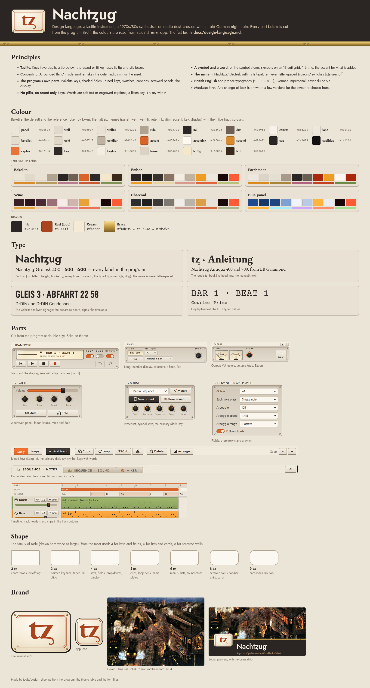

# Nachtzug design language

How Nachtzug looks and feels, written down so that every new screen looks and feels like the ones that exist. It is
for the owner and for anyone, person or AI agent, who builds something new.

Every number, colour and rule below was read from the code and the files named beside it. Where the code is unclear
or disagrees with itself, the point is in [the decisions](#12-decisions-on-the-open-questions) at the end, not guessed.

A one-page overview with the colours, typefaces, real parts and the brand is
[design-language.png](design-language.png), drawn by `tools/design_sheet.py` (run it again after the look changes).

## 1. Purpose and how to use this document

- **Before you draw anything**, read sections 2 and 11. Most of what a new screen needs is already built: look in
  section 6 for the part first, and use it by its object name or class.
- **Colours are never typed into a new widget.** Take them from the theme (section 3), so that all six colour themes
  keep working.
- **Anything that changes the look of Nachtzug starts as mockups** for the owner to choose from, and is built only
  after the choice (`docs/roadmap.md`, `docs/polish-list.md`). This document describes what was chosen; it is not a
  licence to restyle.
- Where this document and the code differ, the code is what the program does, and the difference belongs in
  section 12.

Where things live:

| What | Where |
|---|---|
| Themes, the style sheet, fonts | `src/theme.cpp` |
| Theme colour names, `tactile`, symbol keys | `src/widgets.h` |
| Painted parts: keys, wells, screws, symbols, logo | `src/drawing.cpp` |
| Knob, display (LCD), VU meter, switch, toast, top bar emblem | `src/controls.cpp` |
| Screwed wells, folding sections | `src/panels.cpp` |
| Top bar | `src/mainwindow.cpp` (`buildTopBar`, `fitTopBar`) |
| Sound tab, mixer, timeline, loops, note editor | `src/soundpanel.cpp`, `mixer.cpp`, `timeline.cpp`, `loops.cpp`, `editor.cpp` |
| Welcome, Save sound, sound library, export | `src/welcome.cpp`, `savesounddialog.cpp`, `soundlibrary.cpp`, `exportdialog.cpp` |
| Fonts | `assets/fonts/`, `tools/fonts/` |
| Logo, social card, cover art | `tools/logo/`, `assets/logo/`, `tools/cover/` |
| Website, manual | `site/assets/css/style.scss`, `docs/manual/manual.css` |

To see the program: `QT_QPA_PLATFORM=offscreen SDL_AUDIODRIVER=dummy ./build/nachtzug --screenshot /tmp/x.png
--size 1560x980 --lang en` (also `--dialog welcome|settings|savesound|library|export`, `--tab 1`, `--theme NAME`).

## 2. Design philosophy and principles

Nachtzug is **a tactile instrument**: a 1970s or ’80s synthesiser or studio desk crossed with an old German railway.
From the instrument come Bakelite keys, ribbed knobs, screwed panels, engraved captions and a lit display. From the
railway come the night train, enamel station signs, Edmondson card tickets, departure boards and brass fittings. It
is made for beginners, so it should look like something you want to touch and should never look like a form.

The principles, each with its reason:

1. **Things have a physical feel.** Keys stand up on a lip, fields sit a little into the panel, panels are screwed
   down. A beginner learns what is pressable from how it looks. Do not draw flat decoration where a part can be built.
2. **Curves are concentric and edges line up.** An inner curve shares its centre with the outer one (the logo’s
   rules, the selected ring inside a well). Neighbouring things share colours, heights and baselines (the top bar’s
   grid, section 5). The owner notices a frame that is a pixel off.
3. **Use the program’s own parts.** Bakelite keys, fields with an inner shade, joined keys, sliding switches,
   captions, screwed panels, LCD-style displays. If a new screen needs a thing that does not exist, it starts as a
   mockup (principle 8), not as a one-off.
4. **No pills and no round-only buttons.** Rounded tag chips (“pills”) and buttons that are only a circle do not
   exist in Nachtzug. A small note is soft text or a small engraved caption. A listen key is a normal key with a lip
   and the transport’s ▶ symbol.
5. **A pressed or lit key loses its lip and sits lower.** The depth is the information: raised means ready, sunk
   means on. An earlier change that made lit keys level with their neighbours was reverted on purpose; do not
   bring it back.
6. **Warm colour, one accent.** Paper, enamel and ink do the work; one accent colour says “on”, “playing”,
   “selected” or “here”.
7. **Words and symbols together.** A key shows a symbol and a word, or the symbol alone (a setting); the word is
   always in the tooltip. Nothing is only a picture that has to be guessed.
8. **Look changes start as mockups** for the owner to choose from.
9. **Proper typography and British English** in everything a person reads (section 10).

## 3. Colour

### 3.1 The program’s themes

Six themes, in the order of `DEFS[]` in `src/theme.cpp`: Bakelite (the default and the reference), Ember, Parchment,
Wine, Charcoal and Blue panel. The **tactile** flag (keys with depth, ribbed knobs, ivory display, screwed wells,
Nachtzug Grotesk as the window’s type) is true **only for Bakelite**; the other five are flat versions of the same
parts (on purpose; see the decisions, 12.2).

The token names below are the style-sheet tokens (`@panel@` and so on) and, where different, the code’s names in
`namespace theme` (`widgets.h`). Two names mislead: `amber` is the main accent in every theme (orange-red in
Bakelite and Parchment), and `ice` is the second accent.

#### Values set in the theme table

| Token (code name) | Bakelite | Ember | Parchment | Wine | Charcoal | Blue panel |
|---|---|---|---|---|---|---|
| `panel` | `#ebe5d8` | `#2b2623` | `#ece8df` | `#3b1f26` | `#2e2d2d` | `#1f4b8e` |
| `well` | `#e1d9c9` | `#1d1917` | `#dcd5c7` | `#2a141a` | `#1f1f1f` | `#163868` |
| `wellHi` | `#e9e2d4` | `#3a322c` | `#e5dfd2` | `#4a2a32` | `#3a3938` | `#1d4680` |
| `rule` | `#b1a391` | `#8a7565` | `#a89a8a` | `#9c6f78` | `#7d7872` | `#7fa0d2` |
| `ink` | `#2b2623` | `#f3ece0` | `#2b2623` | `#f6ebe6` | `#f0ede8` | `#f1f4f8` |
| `dim` | `#6e6054` | `#c2b3a1` | `#6a5d51` | `#d1b3b0` | `#b9b3aa` | `#b9cae4` |
| `canvas` | `#f6f2ea` | `#141110` | `#f8f5ee` | `#1a0d11` | `#151515` | `#0e1c36` |
| `lane` | `#eee8dc` | `#1f1b18` | `#efe9dd` | `#24131a` | `#1e1e1e` | `#122647` |
| `laneSel` | `#e4dccc` | `#2b2520` | `#e3dbcb` | `#321c24` | `#2a2928` | `#18315a` |
| `grid` | `#e0d7c7` | `#302924` | `#e0d8c9` | `#38202a` | `#2f2e2d` | `#1f3d6e` |
| `gridBar` | `#bfb2a0` | `#57483c` | `#b9ac9a` | `#64404a` | `#504d49` | `#345c9c` |
| `accent` (`amber`) | `#d8642a` | `#ed9d24` | `#a9270a` | `#e8a23a` | `#dba047` | `#ffb53d` |
| `accentInk` | `#fff8ee` | `#2b2623` | `#fff8ee` | `#3b1f26` | `#1f1f1f` | `#15171c` |
| `second` (`ice`) | `#d98a2b` | `#e9d5a1` | `#ed9d24` | `#f0c9a8` | `#d9d2c5` | `#a6ecff` |
| `cap` | `#2a2624` | `#161210` | `#fbf8f1` | `#16090d` | `#111111` | `#15171c` |
| `capEdge` | `#141211` | `#cdbfae` | `#9a8b7b` | `#d9bfb8` | `#c8c2b8` | `#c9ced6` |
| `capInk` | `#e8743a` | `#f3ece0` | `#2b2623` | `#f6ebe6` | `#f0ede8` | `#f1f4f8` |
| `key` | `#2f2a27` | `#ece8df` | `#ed9d24` | `#f2e6dc` | `#e6e2da` | `#e9ecf0` |
| `keyInk` | `#f3ece0` | `#2b2623` | `#2b2623` | `#3b1f26` | `#1f1f1f` | `#15171c` |
| `hover` | `#dcd3c3` | `#4a3f37` | `#d6cdbc` | `#5a343e` | `#48463f` | `#2a5ba6` |
| `lcdBg` | `#f4e8c9` | `#190807` | `#fbf8f1` | `#190807` | `#190807` | `#190807` |
| `lcd` | `#3b2a1b` | `#ff5a36` | `#a9270a` | `#ff5a36` | `#ff5a36` | `#ff5a36` |

#### Track (role) colours, also in the table

| Role | Bakelite | Ember | Parchment | Wine | Charcoal | Blue panel |
|---|---|---|---|---|---|---|
| Bass | `#d98a2b` | `#ed9d24` | `#d98a1c` | `#e8a23a` | `#dba047` | `#ffb53d` |
| Sequence | `#b79b5c` | `#e9d5a1` | `#a9853c` | `#f0c9a8` | `#d9d2c5` | `#a6ecff` |
| Pad | `#b77a8e` | `#d79a8c` | `#b0627f` | `#d98fb0` | `#c79a8f` | `#c9a7ff` |
| Lead | `#c95a33` | `#e2643b` | `#c2401f` | `#f0714f` | `#d4683c` | `#ff8f6b` |
| Drums | `#7f9356` | `#b9c27a` | `#6f8a45` | `#bfc48a` | `#a9b58a` | `#9fe08c` |

#### Derived tokens

`styleSheet()` computes these from the values above, so a theme never states them. The hex values here were worked
out from the formulas (Qt’s `lighter`/`darker` work on the HSV value; `mix(a, b, t)` is a straight blend), and may
differ from the program’s by one in the last digit. The formulas are what counts.

| Token | Formula | Bakelite | Ember | Parchment | Wine | Charcoal | Blue panel |
|---|---|---|---|---|---|---|---|
| `slot` (code only) | `gridBar` in a light theme, else `canvas` | `#bfb2a0` | `#141110` | `#b9ac9a` | `#1a0d11` | `#151515` | `#0e1c36` |
| `field` | `canvas.lighter(102)` | `#fbf7ef` | `#141110` | `#fdfaf3` | `#1b0d11` | `#151515` | `#0e1d37` |
| `fieldShade` | `mix(field, rule, 0.55)` | `#d2c9bb` | `#55483f` | `#cec5b9` | `#62434a` | `#4e4c48` | `#4c658c` |
| `panelHi` | `panel.lighter(103)` | `#f2ecde` | `#2c2724` | `#f3efe6` | `#3d2027` | `#2f2e2e` | `#204d92` |
| `keyHover` | dark key: `key.lighter(150)`, else `lighter(108)` | `#463f3b` | `#fffbf1` | `#ffa928` | `#fff6ee` | `#f8f4eb` | `#fcfdff` |
| `keyPress` | dark key: `key.lighter(190)`, else `darker(118)` | `#59504a` | `#c8c5bd` | `#c9851f` | `#cdc3ba` | `#c3c0b9` | `#c5c8cb` |
| `keyEdge` | `rule` | `#b1a391` | `#8a7565` | `#a89a8a` | `#9c6f78` | `#7d7872` | `#7fa0d2` |
| `keyDeep` (the lip) | `rule.darker(125)` | `#8e8274` | `#6e5e51` | `#867b6e` | `#7d5960` | `#64605b` | `#6680a8` |
| `amberHi` | `accent.lighter(118)` | `#ff7632` | `#ffb33f` | `#c72e0c` | `#ffba53` | `#ffbc56` | `#ffc76b` |
| `amberDeep` | `accent.darker(150)` | `#90431c` | `#9e6918` | `#711a07` | `#9b6c27` | `#926b2f` | `#aa7929` |
| `ivoryHi` | `lcdBg.lighter(108)` | `#fff5db` | `#1b0908` | `#ffffff` | `#1b0908` | `#1b0908` | `#1b0908` |
| `ivoryLo` | `lcdBg.darker(106)` | `#e6dbbe` | `#180807` | `#edeae3` | `#180807` | `#180807` | `#180807` |
| `frame` | `rule.darker(125)` | `#8e8274` | `#6e5e51` | `#867b6e` | `#7d5960` | `#64605b` | `#6680a8` |
| `lcdText` | `ink` on a light display, else `lcd.lighter(125)` | `#2b2623` | `#ff8e76` | `#2b2623` | `#ff8e76` | `#ff8e76` | `#ff8e76` |
| `zoneU` | `panel.darker(102)` (flat: `panel`) | `#e6e1d4` | `#2a2522` | `#e7e3db` | `#3a1e25` | `#2d2c2c` | `#1e4a8b` |

The style sheet’s own `@slot@` is always `gridBar` (with `slotDeep` = `gridBar.darker(118)` and `slotHi` = `gridBar.lighter(110)` for a slider’s groove), which is what card-index tabs and the groove use; the `slot` above is what drawn parts use (empty slider slots, switches, meters, knob rings).

Fixed in every theme (not themed):

| Token | Value | Used for |
|---|---|---|
| `keyTop`, `keyBot` | `#f3eee4`, `#e2dacb` | The cream face of a tactile (Bakelite) key; painted keys use `#f5f0e7` to `#e2dacb` |
| hover top | `#ffffff` | The lit top of a hovered key |
| `clipInk` | `#221c18` | Dark marks on the coloured clips and notes, in every theme |
| primary lip | `#120f0d`, border `#000000` | The dark (primary) key’s lip and edge in Bakelite |
| red | `#c4361c` | Mute lit, record dot, the VU meter’s red zone |
| red key | `#e0563c` to `#b8361f`, lip `#7a2010`, text `#fff8ee` | Lit mute and record keys (tactile gradient); flat: `#c4361c` on `#7a2010` |
| record dot on the lit red key | `#fff3e6` | Cream, so it shows on the red |

`isLight()` (the canvas lightness above 128) is true for Bakelite and Parchment. A key is “dark” when its colour has a
lightness below 128: Bakelite, Charcoal and Blue panel have dark primary keys, the rest light ones. A new part that
cares about this asks `theme::isLight()` and does not compare colours by hand.

### 3.2 What each token is for

| Token | For |
|---|---|
| `panel` | The window and dialogs (in Bakelite a gradient from `panelHi` down to `panel`); the timeline’s header column |
| `well`, `wellHi` | A recessed or raised surface: menu, status bar, ruler, text boxes (`well`); keys of the flat themes, the chosen sound, a selected track header (`wellHi`) |
| `field` | The inside of a drop-down or number box in Bakelite, with `fieldShade` along its top edge |
| `rule` | Every border, divider and disabled text; the lip of a key is `rule` darkened |
| `ink` | Text, the playhead, the selected clip’s outline |
| `dim` | Secondary text, captions, scale marks, unselected tabs |
| `canvas` | The timeline, the note grid, the room behind clips |
| `lane`, `laneSel` | A track’s row in the timeline; the selected track’s row |
| `grid`, `gridBar` | Beat lines; bar lines, empty slider slots, scroll handles, disabled borders |
| `accent` (`amber`) | **On.** A lit key, a lit switch, the playing thing, the selected ring (2 px), the loop bar, a slider’s filled part, the knob value ring, hover on a divider, the focus line along the top of the focused view |
| `accentInk` | Text and symbols on the accent |
| `second` (`ice`) | A knob’s small MIDI ring, nothing else; do not give it new jobs lightly |
| `cap`, `capEdge`, `capInk` | The moulded dark parts: fader handles, the pivot cover of the VU meter, the root-note key in the note editor; `capInk` is the pointer line on a knob |
| `key`, `keyInk` | The primary (“dark”) key |
| `hover` | The lit item under the mouse in menus and lists; the flat keys’ hover |
| `lcdBg`, `lcd` | The display, tempo/key/scale readouts, VU face, tooltips, automation lines, the level bars, the record key when on in flat themes |

### 3.3 Track and role colours

Each track has a role (bass, sequence, pad, lead, drums; `enum Role` in `model.h`) and so a colour (`theme::trackColor`).
The colour appears as the clip, the 5 px edge on the track’s header, the volume slider’s fill, the mixer strip’s fader,
and the filter and envelope pictures. Nothing else is coloured by role.

- Clip fill: in Bakelite `track.lighter(118)`, `lighter(108)` under the mouse or when selected, the plain track
  colour when it plays (`blockFill`). In the flat themes the colour is see-through: alpha 150, 215 under the mouse,
  255 when playing.
- A selected clip has a 2 px `ink` outline; the clip shown in the editor has a 1.5 px outline (`track.darker(170)` in
  Bakelite, `lighter(140)` in the flat themes).
- Marks drawn on a coloured clip (repeat ticks, notes, the clip’s name) use `clipInk`, never a theme colour, so they
  read on every track colour.
- Transitions are a dark wedge, black at alpha 90.

### 3.4 Accent rules

1. One accent colour at a time. Several lit things in a row is fine; two different “lit” colours is not.
2. Use the accent only for state (on, playing, selected, focus) and for the one detail of a symbol that matters.
3. Text on the accent is `accentInk`. A symbol on a lit key is drawn wholly in `accentInk`.
4. Do not add a new accent. The red for mute and record is fixed and is the only other state colour: **one red,
   `#c4361c`**, for mute, record, the VU’s red zone and a knob’s “has recorded moves” dot. (The lit red key’s gradient,
   `#e0563c` to `#7a2010`, is that red shaded, not a second red.)
5. Display colour (`lcd`) is for readouts and live values; use it for new live numbers and traces, not for buttons.

### 3.5 Brand colours

| Name | Value | Where |
|---|---|---|
| Ink | `#2b2623` | Logo rim and type; the program’s Bakelite ink; the website and manual ink; manual cover and footer ground |
| Rust | `#a9441f` | The logo’s tz and rule (`tools/logo/enamel.py`) |
| Cream | `#f4ead6` | The logo’s enamel (and the tz on the dark sign) |
| Brass | `#f6dc95` to `#c9a24a` (at 45 %) to `#7d5f25`, with a `#3a2c14` line at each edge | The strip under the painting, the dark sign’s rim |
| Brass screw | `#f3d488` to `#c9a24a` (at 55 %) to `#8a6a2c`, edge `#5c4524`, slot `#4a3618` | Screws on the signs and the strip |

The enamel sign’s fields: cream is `#fffaf0`, `#f4ead6`, `#e3d4b6` (domed, lightest top left); dark is `#3d3530`, `#2b2623`,
`#211c19`. The ink rim goes `#4a413b` to `#1a1614`.

**One brand rust.** `#a9441f` is the rust for everything about Nachtzug outside the program: the logo, the website
(`--rust` and `--link`), the manuals, the social card. Inside the program the accent belongs to the theme (`#d8642a` in
Bakelite, `#a9270a` in Parchment, and so on) and is not changed to match.

### 3.6 The website’s palette

From `:root` in `site/assets/css/style.scss`; dark values apply under `prefers-color-scheme: dark`, and are the
program’s Ember. The light values are Bakelite’s, with the paper a little lighter.

| Token | Light | Dark | For |
|---|---|---|---|
| `--paper` | `#f4efe5` | `#221d1a` | Page ground |
| `--panel` | `#ebe5d8` | `#2b2623` | Alternate sections, cards (Bakelite `panel` / Ember `panel`) |
| `--well` | `#e1d9c9` | `#1d1917` | Wells, `code` |
| `--well-hi` | `#e9e2d4` | `#3a322c` | Top of the top bar and cards |
| `--rule` | `#b1a391` | `#8a7565` | Borders |
| `--line` | `#cbbfac` | `#4a3f37` | Fine dividers |
| `--ink` | `#2b2623` | `#f3ece0` | Text |
| `--soft` | `#6e6054` | `#c2b3a1` | Secondary text |
| `--link` | `#a9441f` | `#f0b45c` | Links |
| `--rust` | `#a9441f` | `#d0663a` | Arrowheads, icons |
| `--amber` | `#e08a2c` | `#ed9d24` | Focus rings |
| `--ochre` | `#c9a24a` | `#c9a24a` | The manual’s third band |
| `--accent` | `#d8642a` | `#ed9d24` | Lit keys (Bakelite and Ember accent) |
| `--star` | `#b8501f` | `#e2733f` | Drop-cap letter |
| `--brown` | `#2b2623` | `#120f0d` | Small dark tags, time stamps |
| `--board-ink` | `#f1c27a` | `#f1c27a` | Text on `--brown` |
| `--board-edge` | transparent | `#4a3f37` | Hairline round `--brown` tags |
| `--lcd-bg`, `--lcd-ink` | `#f0e1ba`, `#3b2a1b` | `#190807`, `#ff5a36` | The ticker, the program’s display |

Fixed website colours (railway signage, not themed): enamel sign `#fbfaf6` on `#151515`; departure board
`#3b2421` to `#2a1715`, glass `#efe8d8` with `#1c0f0e` frame, red lettering `#b4161c`; timetable yellow `#f6d24a` on
`#151515`; footer `#2b2623` with text `#f3ece0`, accents `#e8b77a` and `#f0b860`, quiet text `#9c8a78`/`#d9cbb7`;
hero ground `#2a1513`. Tickets: second class `#c8a77c`, first class `#a9bf93`, plain white `#f1ece0`, stripe
`#b3442f`, print `#1f1a17`, dating ink `#4b3a7a`.

The manual’s palette (`docs/manual/manual.css`): ink `#2b2623`, soft `#6e6054`, paper `#f7f2e8`, panel `#ebe4d6`, line
`#cbbfac`, rust `#a9441f`, amber `#e08a2c`, ochre `#c9a24a`, brown `#2b2623`, lcd `#c9cc9a`. Boxes: note `--panel` with a
2.2 pt ink edge; tip `#f5e2c4` with amber; warning `#f1d6c8` with rust.

## 4. Typography

### 4.1 Typefaces

| Face | Files | Used for |
|---|---|---|
| **Nachtzug Grotesk** (Regular 400, Medium 500, SemiBold 600) | `assets/fonts/nachtzug/` | The program’s interface in Bakelite; the name “Nachtzug” in the top bar, the welcome window, the website, the manual covers, the social card; the website’s keys and labels |
| **Nachtzug Antiqua** (Regular, Bold) | same | The logo’s tz; the website’s and the manuals’ book text and headings; the website footer’s word mark |
| **Nachtzug Initialen** (Rahmen and Buchstabe, two layers; also a colour version) | same | Drop caps: frame in ink, letter in rust (`--star` on the web), 3.47 times the text on the website |
| **Nachtzug Ornamente** | same | Moons, stars, train and track ornaments (`.orn`) |
| **Courier Prime** (Regular, Bold) | `assets/fonts/` | LCD-like text: the display, readouts, the scope’s small labels, key caps on tickets, timestamps, code |
| **D-DIN** and D-DIN Condensed (Regular, Bold) | `assets/fonts/d-din/` | Website only: the railway’s lettering (DIN 1451): platform signs, departure board, timetable, ticker |
| Jost (400, 500, 600) | `assets/fonts/` | The base Grotesk is derived from; shipped, and the manual maps its “Jost” name to Grotesk files |

What makes **Nachtzug Grotesk** ours (`tools/fonts/grotesk/build_grotesk.py`): derived from Jost with a taller
x-height (495 instead of 460), a z whose foot hooks down under the baseline, a g whose ear is a small raised
semaphore arm with its disc, an l with a rail-like foot so that I, l and 1 never meet, a t whose crossbar runs on into
a following z as one rail (the **tz ligature**, `liga` and `dlig`), narrow typographic spaces, and the symbols the
program writes (triangles, squares, discs, arrows, undo and redo, copy squares, check, eighth note, gear, command key)
drawn in the weight of the letters. **Nachtzug Antiqua** is derived from EB Garamond with its own g and z and rail
ligatures tz, ct and st.

All of these are under the SIL Open Font License. Edit the build scripts, never the font files.

### 4.2 The ligature rule

The name **“Nachtzug” is set in Nachtzug Grotesk with the tz ligature** (`font-feature-settings: "liga", "dlig"`; in
Qt `setFeature(QFont::Tag("liga"), 1)` and `dlig`), in the top bar’s emblem, the welcome window, the website, the
manual covers and the social card. **It is never letter-spaced**: a non-zero letter-spacing switches ligatures off in
Qt and in WeasyPrint (and, by the CSS rules, in browsers). The code carries the warning in several places; keep it.

Other text in the program does carry letter-spacing (keys 0.5 px, tabs 1 px, captions up to 2.5 px), so the name must
never be put in a key, a tab, a caption or a title style. In the welcome title only the words “Welcome aboard” are
spaced (2 px) and “Nachtzug” sits in its own unspaced span.

### 4.3 Sizes and weights in the program

All sizes are pixels. The base is 13 px (`QWidget { font-size: 13px }`; Bakelite repeats it as `@uiSize@`).

| Element | Face | Size / weight / spacing |
|---|---|---|
| Window text | Grotesk | 13 / Regular |
| Keys (tactile) | Grotesk | 13 / Medium (500), letter-spacing 0.5 |
| Keys (flat) | system | 13 / 600 |
| Big keys (`big=true`) | | 14 |
| Tap key | | 600 |
| Section name (`QGroupBox::title`) | | 10 / 500, 2.5 spacing (flat: 600, 2) |
| Unit title above a top-bar unit (`#unitTitle`) | | 13 / 400, 0.5 |
| Engraved caption (`#engraved`) | | 9 / 500, 1.4, set in capitals |
| Plain caption (`#cap`, `#dim`) | | 13, colour `dim` |
| Tab (`QTabBar::tab`) | | 600, 1 spacing, text in capitals |
| Knob name under a knob | | 11, 0.3 spacing (flat: 11); the value replaces it while turned or pointed at |
| Switch name (above) | | 12; beside: 13 |
| Card heading (`#cardHead`) | | 15 / 600 |
| Card text (`#cardText`) | | 13, `dim` |
| Chosen sound’s name (`#chosenName`) | | 19 / 600 |
| Dialog title (welcome) | | 22 / 600; the heading label style is `#title`: 600, 1 spacing |
| Toast | | 14 / DemiBold |
| Folded section summary | | 11 / Regular, `dim` |
| Display, first line | Courier Prime Bold | 35 % of the display’s height, between 12 and 17 (3 less in a display under 260 px wide), shrinking to 10 if the words do not fit; set in capitals |
| Display, second line | Courier Prime Regular | a quarter of the height, between 9 and 12; capitals, “·” as separator |
| Readout (tempo, key box) (`#readout`) | Courier Prime Bold | 14 |
| Time line in Settings | Courier Prime Bold | 18 |
| VU meter | Grotesk | numbers 7 Medium; “VU” 8 DemiBold, 1 spacing; channel letter 7 |
| Timeline text | | 11; small 10; track names 12 bold |
| Scope’s small labels | Courier Prime | 8 |

Notes:

- **Weights**: Grotesk ships only 400, 500 and 600, so 600 (SemiBold, `QFont::DemiBold` in code) is the heaviest weight
  in the program. Never ask the Grotesk for 700 or `setBold(true)`: Qt would make up a bold. The Antiqua and Courier Prime
  have a real Bold (700).
- Section names and captions are set in capitals (the code writes them uppercase or calls `toUpper()`); keys, field
  labels and sentences are in sentence case.
- Numbers in the display are lining, monospaced Courier Prime. Note names use ♯ and ♭ (the Grotesk and Antiqua carry
  them); bar and beat are `BAR 3 · BEAT 2`; tempo is `122 BPM`.
- Tooltips use the window font at 13 px in the display’s colours.
- `NZ_UI_FONT=mixed|antiqua` is a comparison switch for trying Antiqua on section names and tabs; it is not a
  setting.

### 4.4 Type on the website and in the manual

Website (`style.scss`): body Antiqua 1.125 rem / 1.55 with `oldstyle-nums proportional-nums`; headings Antiqua 700,
`h2` 2.05–2.9 rem, `h3` 1.35 rem; kickers Antiqua in all small caps with 0.2 em spacing; keys and labels Grotesk 500
at 0.95 rem with 0.03 em spacing; the name Grotesk 600 at 1.4 rem in the top bar and 4–7.75 rem in the opening;
D-DIN 700 for platform signs, D-DIN Condensed 700 for enamel headings, the timetable and the board; Courier Prime
for the ticker’s time stamps, ticket numbers and code. Tickets use Grotesk with `lining-nums tabular-nums` and sizes in
`cqw` so the print scales with the card.

Manual (`manual.css`, A5, WeasyPrint): body Antiqua 9.8 pt / 1.22, justified, hyphenated, `oldstyle-nums
proportional-nums`; paragraphs without a gap and indented 1.4 em except the first after a heading; chapter number
Antiqua 700 40 pt in rust, `h1` 21 pt, `h2` 11.4 pt small caps with a hairline under it, `h3` 9.8 pt in rust; panel
labels, keys and recipe knob names in Grotesk (named “Jost” in the file) 5–7 pt, 600 and uppercase; LCD text and
code in Courier Prime. Keys in the text are drawn as small cream key shapes (`.key`, `.key.dark`, `.key.ico` for the
transport symbols). The cover’s name is Grotesk 600 at 34 pt with the ligature, never spaced.

## 5. Shape and space

### 5.1 Border radii

The program’s corners come in a small family. The same numbers are repeated on the website
(`style.scss` states this at the top).

**The rule: four sizes by role.** 3 for small painted parts inside something (a painted key’s face, a fader handle, a
flat clip); 4 for keys and fields; 6 for lists, cards and boxes that hold things; 8 for screwed wells and the large
cards. A smaller object takes the smaller radius; something inside something else takes the outer radius minus the
inset. The in-between values in the table (2.5, 3.5, 4.5, 5, 5.5, 9) are named exceptions with a reason (a side, a
frame around a glass, a tab) and stay; do not add new ones.

| Radius (px) | Used for |
|---|---|
| 2 to 2.5 | The cutoff tag in the filter picture (2); the chord boxes (2.5); the fader cap in a drawn slider (2.5) |
| 3 | Painted key face (`drawKey`), flat painted key, fader handle, fader slot and meter, the graph paper inside the scope’s frame, flat clips |
| 3.5 | The side of a painted key (the lip) |
| **4** | **Keys, fields, drop-downs, number boxes, the key-and-scale selectors, the display and VU glass (4), menu items, drop-down list items, the undo key in the toast** |
| 4.5 | The thin frame behind the display and the VU meters (their glass plus 1) |
| 5 | Clips and loop cells in Bakelite, the folded section key, the mixer strip’s name plate, the selected clip’s outline, scroll bar handle (5) |
| 5.5 | The dividers’ drawer-pull handle |
| **6** | **Menus, a drop-down’s open list, flat section boxes and mixer strips, sound cards, the chosen-sound panel, text browsers, the toast, the scope’s outer frame, the closed inspector’s tab (right side)** |
| **8** | **Screwed wells and the top-bar units (`drawWell`, `QFrame#unit`), welcome and sound-choice cards (`#card`), the switch track (half its 16 px height)** |
| 9 | The top corners of a card-index tab |

Concentricity is a rule, not a nicety: a selected ring inside a well has radius `8 − 1`; the logo’s inner rules are
the plate’s radius minus their inset (`rx = R − inset`); the display’s frame is 4.5 around 4; the card-index tab’s
selected page runs into the page. When you add a rounded thing inside another, subtract the inset from the outer radius.

### 5.2 Borders, rules and lines

- Borders are 1 px in `rule`; a selected card, strip or well is 2 px in the accent, inside its edge (the 2 px
  border takes the 1 px padding’s place so nothing inside moves).
- Disabled things: no fill (`transparent`), text `rule`, border `gridBar`.
- A divider is a fine 1 px `rule` line (menu separators `gridBar` with 4 px 8 px margins); a draggable divider
  adds a raised pull handle (64×14 px for the horizontal, 14×64 px for the vertical) with three grip lines 6 px apart; the line
  and the handle’s edge turn accent under the mouse.
- The window’s side tab (`#inspectorTab`) is a key on its side, 20 px wide, as tall as the window.
- A field’s inner shade is painted inside one even 1 px border (the top 14 % of the gradient), never as a thicker
  top border: a thicker border met the rounded corners in a step.
- Lines on pictures: 1 px grid; 1.5 px for the display’s trace; 1.3 px for a track’s knob lines over its clips; 2 px for
  an open line lane’s curve, with points of radius 4.

### 5.3 Spacing

| Where | Value |
|---|---|
| Base font | 13 px |
| Key padding (flat / tactile) | `0 12px` / `0 12px 3px 12px`, the lower 3 px being the lip; pressed `2px 12px 1px 12px` |
| Key height | tactile `min-height: 25px` plus the 3 px lip; flat `28px`. The code calls it 28; the top bar measures a real key (`fitTopBar`) |
| Transport key | 23 + 3 (tactile) / 30 (flat), 44 px wide; big keys 31 / 32 |
| Field height | 26 px tactile, 28 px flat; radius 4; padding `0 8px` |
| Key-and-scale selector | 23 + 3 px lip, padding `0 6px 3px 10px` |
| Drop-down arrow | 10×6 px, 1.7 px round stroke, 6 px from the edge; the arrow zone 18 px |
| Menu | padding `4px 0`, item `4px 22px 4px 14px`, margin `0 4px` |
| Tooltip | padding 4 px |
| Section (`QGroupBox`, Bakelite) | `GROUP_TOP` 17 px above the well for its name, padding `5px 8px 3px 8px`, title 10 px in from the left |
| Section folded | a 32 px high long key |
| Scroll bar | 12 px, handle radius 5, min 24 px; hidden by default (see 6.18) |
| Tab | padding `6px 20px`, top margin 5 px for the unselected; the selected one is 5 px taller (`margin-top: 0`, `padding-bottom: 11px`) and neighbours overlap by 1 px |
| Dialog margins | Welcome `26,22,26,18`, spacing 14, 640 px wide; Save sound `22,18,22,16`, spacing 6; Arrange for me `20,18,20,14`, spacing 12; the help window `18,16,18,14`, spacing 12 (its sign 56 px) |
| Cards | Welcome card: margins `16,10,16,10`, spacing 4, min height 88 px; sound card row margins `8,6,10,6`, spacing 10; chosen-sound panel 250 px wide, margins `14,12,14,12` |

### 5.4 The top bar’s unit grid

The top bar is the clearest example of the principle “everything lines up”. It is the emblem and then three framed
units of one width (Transport, Song, Output), each a row of names in small engraved capitals over two rows of
controls, every control as tall as a key.

| Constant | Value | Means |
|---|---|---|
| `TB_LABEL` | 11 px | Height of the row of engraved names |
| `TB_GAP_TOP` | 4 px | Between a name and its control |
| `TB_GAP_ROWS` | 6 px | Between the two rows of controls |
| `TB_PAD` | 8 px | Vertical padding inside a unit’s well |
| Title row | 18 px high, 3 px above the well | The unit’s name (`#unitTitle`) |
| Unit well | inner margins `17, 8, 17, 8` | 17 px clears the screws in the corners |
| Unit height | `8 + 11 + 4 + key + 6 + key + 8` | Set by `fitTopBar()` from a real key’s height, once the style sheet is applied |
| Bar margins / spacing | `14, 8, 14, 10` / 12 px | Round the three units and the emblem |
| Emblem | 86×86; the sign 56 px with “Nachtzug” 18 px DemiBold under it | Gives way when narrow: smaller, then only the sign, then gone |
| Display height | `11 + 4 + key` | Its own height spans the name row and the first control row |
| Knob column | `key + 6 + key` high | A knob spans both rows, centred, its name above it |
| Widths | switch 35, transport key 44, others 40, tempo box 88, Tap 88, key box 72, scale box 160 (“Phrygian dominant” is longest), Export `max(66, text + 22)`, zoom keys 34 | |

A new control in a unit takes the rows: a name in `#engraved` above, a control one key tall beneath, 4 px between
and 6 px to the next row. Do not give a unit a height of its own.

The bottom bar above the timeline: margins `8, 0, 8, 0`, spacing 6, a joined Song | Loops pair, then Add track (a
primary key), then the tools of the view shown. The bottom area has `0, 4, 0, 0` margins and 4 px spacing.

Timeline geometry (`timeline.h`): header column 214 px, ruler 20, loop row 16, chord row 22 (so the first track starts
at 58), track row 58, open line lane 72. The loop grid (`loops.h`): header 214, column row 22, chord row 26, foot 44, cell row
58, cells 104 wide, growing to the space. The note editor: key column 76, ruler 20.

### 5.5 Depth, shadows and the lip

Depth is drawn in a fixed way. Light comes from above. A thing that stands up has a lighter top and a darker lower
edge or lip; a thing sunk in has a shade under its top and left edges and a light line under its bottom edge.

**The key’s lip.** In Bakelite the lip is the bottom band of the key’s own gradient, so it follows the rounded
corners exactly (a thicker bottom border joined the corners badly):

| State | Gradient (top to bottom) | Padding |
|---|---|---|
| Normal | `keyTop` to `keyBot` at 89.5 %, then `keyDeep` from 90 % (about 3 px of 28) | `0 12px 3px` |
| Hover | `#ffffff` to `keyTop` at 89.5 %, lip as normal | same |
| Pressed | `keyBot` flat to 96.2 %, then `keyDeep` (about 1 px) | `2px 12px 1px`: the face sinks 2 px |
| Lit (checked) | `amberHi` to `amber` at 96.2 %, then `amberDeep` from 96.7 % | same as pressed |
| Disabled | transparent, text `rule`, border `gridBar` | |
| Primary | `keyHover` to `key` at 89.5 %, lip `#120f0d`, border `#000000`, text `keyInk`; hover brightens the whole face; pressed as above | |

A lit key keeps its colour and loses its lip: it sits lower than its neighbours, on purpose.

The export key (`#exportKey`, a tall key with an icon over its word) uses a lip at 95 % and a pressed lip at 98 %, the
same band in proportion to its height.

**Painted keys** (`drawKey`, on the timeline’s headers and the loop grid’s scene keys): raised depth 2.5 px, lit
depth 1 px with the face 1.5 px lower; face radius 3, side radius 3.5; face gradient `#f5f0e7` to `#e2dacb`; lit
gradient `colour.lighter(118)` to `colour`, side `colour.darker(150)`.

**The well** (`drawWell`, around every section, top-bar unit and mixer strip): radius 8; a light lower lip (white, alpha 200,
1 px below), a shadowed upper lip (`#6e5a41`, alpha 70, 1 px above), a floor in `mix(panel, rule, …)` from 42 % at the top
to 15 % at the bottom with a `rule.darker(128)` edge, a shade 10 px deep under the top edge and 5 px along the left,
a light line along the bottom (white, alpha 140), and **a screw in each corner**: radius 3.5, centre 9.5 px in from
both edges, a slot 4.8 px long, each turned a different way (30°, −50°, 75°, 10°, plus an amount from the well’s width)
as if put in by hand. The selected well gets a 2 px accent ring just inside its edge.

**Other shadows**: clips and cells a 3-layer soft shadow (black alpha 26, 18, 10, 1 to 3 px down) with a gradient
`colour.lighter(106)` to `darker(108)`, a `darker(140)` edge and a thin white top highlight (alpha 70); knobs a 4-layer round shadow;
a switch’s knob a 1.2 px offset shadow; the toast a 2 px offset shadow; menus and drop-down lists none (their native
shadow is turned off so it does not show square behind the round corners).

## 6. Components

Use these by object name or class. A state not listed here does not exist.

### 6.1 Keys

`QPushButton` and `QToolButton`. Bakelite: cream moulded key with a lip (5.5). Flat themes: `wellHi` face, 1 px `rule` border.

| State | Look |
|---|---|
| Normal | As the table in 5.5; text `ink`, Medium 500 with 0.5 px letter-spacing |
| Hover | Lit top |
| Pressed | Sinks 2 px; the lip shrinks |
| Checked (lit) | Accent face, `accentInk` text; sinks like pressed |
| Disabled | No fill, `rule` text, `gridBar` border |
| `#primary` | The dark key (the program’s “main action” key: Add track, Start making music, Save, Export dialog’s Export, New take). Dark in Bakelite, Charcoal and Blue panel; light in Ember, Wine and Parchment (Parchment’s is the amber-orange key) |
| `#rec:checked`, `#mute:checked` | The red key (`#c4361c`, tactile gradient `#e0563c` to `#b8361f`), cream text; flat record is the display colour |
| `[big="true"]` | 14 px text, 31 px (flat 32) high, `0 14px` padding |
| `[transport="true"]` | The transport keys: back, play, stop, record, 44 px wide, symbol only |
| `#tap` | 26 px high, `0 10px`, weight 600 |
| `#help` | The small “?” key: 15 px high, 20 px wide |
| `#sample` | `0 6px` padding, Regular; lit sample text turns accent (`[sampleOn]`) |

The dark key marks the main action of its area (Add track, New idea, New take, Save, Export, Use on this track); keep it to one in a row of keys.

**Symbol keys.** A key shows a symbol and a word, or the symbol alone (Settings, Keys: “A symbol and a word” or
“Symbols only”). Mark a key once with `theme::symbolKey(button, kind, word, alone)`; `dressSymbolKeys(root)` gives every
marked key its icon, text and tooltip again after the look or the setting changes. Mute, Solo and the track rows’ Stop are
always symbol-only (`alone`). A key that loses its word says it in its tooltip. A key that opens a menu keeps its ▾
arrow. Symbols are drawn by `drawSymbol` (section 7). The symbol is 18 px on the key and the icon of a primary key
is drawn in `keyInk`.

### 6.2 Joined keys

`QPushButton#segL`, `#segM`, `#segR`: one switch with several positions, made of checkable keys with no gap. `segL`
has no right-hand corners, `segR` no left-hand ones and no left border, `segM` no corners and no left border; margins 0.
Examples: Song | Loops, the welcome window’s Keys, Timeline and Scroll bars choices, the group keys in Save sound (a
`QButtonGroup`, one choice among them), Export’s kind, What and Ending, Chop’s Cut at, Arrange’s Short | Medium | Long,
the website’s EN | DE language switch. Keep the words on the keys short; what the chosen one does goes in a soft
(`#dim`) line beneath. There are no round option buttons (`QRadioButton`) in Nachtzug. Put the chosen one lit. Use joined keys
for two to five exclusive choices; use a drop-down for more.

### 6.3 Switches

`Switch` (`controls.cpp`): a sliding switch for a setting that stays on or off. **Use these instead of tick boxes**,
everywhere; there are no tick boxes left in the program. The track is 34×16 px with radius 8 (a slot); its colour moves from `slot` to
the accent and its border from `rule` to `amber.darker(130)`; a shade under its top edge fades as it fills; the knob is
a cream disc of radius 6.5 with a soft shadow, 8 px in from the track’s ends, sliding in 140 ms (OutCubic), or straight there if
the switch is not shown. Two placements: `Above` (64×40, the name 12 px in `dim` above the track: the top bar’s
Loop, Click, In time) and `Beside` (22 px high, the name 8 px to the right of the track in `ink`: settings and dialogs).
Disabled: the name and border `rule`.

### 6.4 Knobs

`Knob` (`controls.cpp`): drag up or down (170 px for the whole range; Shift 700 px for small steps), double-click to
reset, no keyboard focus; the cursor is a vertical size cursor; its default tooltip says so. Its size is 58×78 px
(50 high when its name is in a caption above), or ×`scale` for the Sound tab’s simple page (`setScale`).

Tactile drawing, in a 44 px dial: a printed scale of 11 marks over 270° starting at 225° (the longer ones at 0, 5 and
10, radius 20.5 to 23 and 22, 1.4 and 0.9 px, in `dim`); a value ring of 36 px diameter, 2.5 px, in `gridBar` with the
value in the accent (so each track’s knobs take their track’s colour through `setAccent`); a soft shadow;
a ribbed skirt of 28 beads (radius 13.4, bead 1.7); a cap of radius 10 with a radial gradient; a pointer line from radius 4 to 9.5, 2.4 px
round, in `capInk`. The name sits under it in 11 px (`dim`), and becomes the value (`ink`) while turned or pointed at.
In the top bar the name is a capital caption above (`#engraved`) and shows the value there. Flat themes draw a plain
cap and a 4 px ring.

Marks: a small red dot (`#c0361c`, radius 3) at the top right when the knob has recorded moves; a small ring in the second
accent at the top left when a MIDI controller turns it. A disabled knob is drawn at 45 % opacity.

### 6.5 Fields and drop-downs

`QComboBox`, `QSpinBox`, `QLineEdit` and the like.

- **Field** (Bakelite): `field` (a tint lighter than the canvas) with `fieldShade` painted along its top 14 %, 1 px `rule`
  border, radius 4, 26 px high, `0 8px` padding. Flat: `well`, 28 px.
- **`QComboBox#selector`**: a key with the value on it that opens its list (key and scale in the top bar). It is a key,
  23 px plus the 3 px lip, so it lines up with the keys beside it.
- **`#readout`** (`QSpinBox`, `QComboBox`): the display look: ivory (or dark) glass, Courier Prime Bold 14 px in `lcd`,
  a `frame` border, radius 4; its arrow is `lcd`. Tempo and the key and scale boxes’ readout use it.
- The open list is a window of its own, drawn rounded by `WellPainter` (`well`, 1 px `rule`, radius 6) with
  see-through items 24 px high and radius 4 that light up in `hover`; the readout’s list uses the window font in `ink`.
- No up and down buttons on number boxes.

### 6.6 Captions and engraved labels

- **`QLabel#engraved`**: 9 px, Medium, 1.4 px spacing, capitals: the printed name above a control, used in the top bar.
- **`QLabel#cap`**: 13 px `dim`: the small heading above a field in a dialog (Save sound’s Name, Group).
- **`QLabel#dim`**: `dim` text for the quiet line or a hint.
- **`QLabel#title`**: 600 weight with 1 px spacing, for a question or heading inside a dialog.
- **`QLabel#unitTitle`**: 13 px, 400, 0.5 spacing, `ink`, above a top-bar unit.

Hints and units are never boxed or coloured as chips. A short note beside a thing is `dim` text or an engraved caption.

### 6.7 Panels with screws (`QGroupBox`, `QFrame#unit`, `QFrame#strip`)

In Bakelite every `QGroupBox`, every top-bar `#unit` and every mixer `#strip` is painted as a **screwed well**
by `installWells()` (`WellPainter`, a filter on the whole application), so a new group box needs no code. The
group’s name stands above the well, 10 px with 2.5 px spacing, `GROUP_TOP` (17 px) from the top. Keep a group’s
content 17 px (units) or 8 px (groups, strips) in from the sides, clear of the corner screws; in a strip the keys sit between the screws
(`0, 8, 0` margins and slimmer key padding). Flat themes: a 1 px `rule` box, radius 6, name inset on the border.

**Foldable sections**: `makeFoldable(group, key, summary)`. The name is “▾ Name” (open) or “▸ Name” (folded); clicking the name
folds the section into a **long key** (32 px high, radius 5) showing ▸, the name and a one-line summary in 11 px `dim`
(by default the choices of its drop-downs, or the first three knobs and values, separated by “·”). The state is remembered per
key in the settings.

### 6.8 Card-index tabs

`QTabWidget` and `QTabBar::tab`: tabs like a card index. The chosen tab is the page’s own colour and runs into the page (no line
between), the others stand back 5 px, darker, with a gradient from `well` to `gridBar`; top corners radius 9, 1 px
`rule` border, neighbours share a border (margin −1 px), `padding 6px 20px`, text in capitals, 600, 1 px spacing, `ink`
when chosen and `dim` otherwise. The page has only a 1 px top rule. Use tabs for parts of one thing (Notes, Sound,
Mixer; the Settings pages); not for modes you switch often (use joined keys).

### 6.9 Drawer-pull dividers

`QSplitter::handle`: a 14 px strip with a fine line in the middle and a raised **pull** (64×14 or 14×64, radius 5.5,
`wellHi` gradient, three grip lines 6 px apart in `dim`). Under the mouse the line and the pull’s edge and grips go accent. The pictures
are drawn as PNG at 1×, 2× and 3× in the temporary folder (no SVG plugin is needed).

### 6.10 The display (LCD)

`Lcd` (`controls.cpp`): the transport’s display. 380×58 by default, 300×52 at least (the top bar gives it its own
height). In Bakelite, ivory glass lit from below (`drawIvory`: radial gradient `ivoryHi` to `lcdBg` to `ivoryLo`, a 2 px
`rule.darker(150)` rim) in a thin 4.5-radius frame, a shade 8 px deep under the top edge, and a reflection on the glass. Content: a scope
trace on the left (`lcd`, 1.5 px, up to 84 px wide; only if the display is at least 200 px wide), a printed vertical
line, then two lines of Courier Prime in `lcd`: the first `▶  BAR 1 · BEAT 1` (the state sign is ■ ▶ ● REC ○ REC), the second a short message in capitals
(“PRESS SPACE TO PLAY”, “CHANGE LANDS ON THE NEXT BAR”, “KEYS PLAY: BASS”). A level bar, 3 px wide, runs up the right edge.
Messages last 3.5 s. Under 34 px high the two lines become one. The display colour is the one colour for the display,
tempo, key and scale boxes, the meters and the tooltips; Bakelite’s is warm ivory with brown, the dark themes’ black with red.

### 6.11 VU meter

`VuMeter`: 82×57 px, a needle meter in the same frame and glass as the display. The scale is −20 to +3 dB over 90°,
wider near 0 as on a real meter (pairs listed in `paintEvent`), the arc and ticks in a dark brown (`#3a332e`; `lcd` on a dark face), red from 0 up (`#c4361c`, 2.6 px
arc), numbers −20, −10, −5, 0 and +3 outside the arc, “VU” in the middle and the channel letter at the corner; the needle
rises fast (55 % per step) and falls slowly (12 %); the pivot is under a black cover. A meter shows the level; use it only for
the output. Per-track and per-strip levels are the thin bars described in 6.12 and 6.13.

### 6.12 Faders, sliders and level bars

- **Mixer fader** (`Fader`, 46×120 minimum): a 6 px slot (radius 3) with the filled part in the track’s colour, a 6 px
  level bar beside it (`ink`, changing to `lcd` above 85 %), and a handle 24×14 (radius 3, `cap` with a `capEdge` edge and a
  `capInk` centre line). Shift gives fine steps.
- **Slider** in the window (`QSlider`, Bakelite): an 8 px groove (radius 4, a top-down gradient `slotDeep`, `slot`, `slotHi`),
  filled part in the accent, handle an 18×26 cap picture drawn as PNG (dark moulded body, a light line at the top, a
  3 px accent line down it, a soft shadow).
- **Timeline header slider** (`drawSlider`): the same, in the track colour, with the track’s live level as a 3 px `ink` bar under it.

### 6.13 Mixer strip

`QFrame#strip` (138 px wide; the input strip 196, the whole-song strip 138): a screwed well with the strip’s name on an
ivory plate (`QPushButton#stripName`, radius 5, 2 px `rule` bezel, 24 px high, margin `4 6 0 6`, the display’s ivory
gradient, the track icon beside a 700-weight name), three or more knobs, the fader, and Mute and Solo keys between
the lower screws. The selected strip has a 2 px accent ring inside its edge (`[sel="true"]`). The coloured edge
under the name follows the plate’s corners. Layout: margins 8, spacing 6.

### 6.14 Sound cards and the sound library

- **Welcome choice cards** and **sound-card buttons** (`QPushButton#card`): `well`, 1 px `rule`, radius 8, text left
  aligned; hover `hover`; chosen `wellHi` with a 2 px accent border. Heading `#cardHead` (15 px, 600), body `#cardText`
  (13 px `dim`).
- **Sound library** (`soundlibrary.cpp`, the card index): shelves as keys on the left (150 px minimum, the chosen one
  lit), a search field and the list of cards in the middle, the chosen sound on the right (`#soundChosen`, 250 px, `wellHi`,
  radius 6). A list card (`#soundCard`): `field` background, 1 px `rule`, radius 6, 2 px accent border when it is
  the one on (`[on="true"]`); a **normal key with the ▶ symbol (30×26) to listen** (not round), the sound’s name in `#cardName` (600) and
  its group as soft `dim` text on the right. Words to find a sound by are soft text, never chips. Its actions are normal keys in a
  column, the main one `#primary`.

### 6.15 Dialogs

A dialog is a `QDialog` on the `panel` gradient with its content in these parts: a `#title` or a large heading, `#cap` captions above fields, fields, joined keys for choices, switches for settings,
and at the bottom a `QDialogButtonBox` whose accepting key is `#primary` and whose other keys are plain; the
accepting key is on the right. Margins `20 to 26` px, spacing 6 to 14 px (see 5.3). The welcome window is the model: heading, a mark (the
sign at 84 px) with a paragraph, language, two large cards, joined-key choices each with its small caption at left, a quiet `dim`
sentence, and one primary key at bottom right.

### 6.16 Tooltips

`QToolTip`: `lcdBg` background, `lcdText` text, 1 px `lcd` border, 4 px padding. **Every visible control has a tooltip in plain words**
(`--check-tooltips` must print `0 controls without a tooltip`). A key that shows its symbol alone repeats its word in
its tooltip as “Word: explanation”.

### 6.17 Menus

`QMenu` and `QMenuBar`: `well` (in Bakelite the menu bar is `panelHi` with a 1 px `rule` under it), 1 px `rule` border,
radius 6, 4 px vertical padding, items `4px 22px 4px 14px` with radius 4 and a 4 px side margin; the item under the mouse is `hover`;
separators 1 px `gridBar`, margin `4px 8px`. The menu’s window is made frameless, translucent and shadowless so the corners are truly round.

### 6.18 Scroll bars

**Hidden by default** in the window: the wheel and the trackpad scroll as before and **Shift + wheel scrolls sideways** in the
notes, the timeline and the loops. Settings, General, “Show scroll bars” brings them back. Drop-down lists, text boxes
and dialogs keep theirs (`applyScrollBars()`; a scroll area that never scrolls sideways sets `noHBar`). When shown: 12 px,
`canvas` track, `gridBar` handle with radius 5, no arrow buttons. A new scroll area in the window needs no code for
this; one with only a vertical scroll sets `noHBar`.

### 6.19 Toast

`Toast` (`controls.cpp`): the note that rises after a big change, 44 px high, 44 px above the bottom edge, centred; an ivory
plate (the display’s colours, radius 6, 1.5 px `rule.darker(130)` rim, 2 px shadow) with 14 px DemiBold text and a real key for the action
(“Undo”: radius 4, with a lip, hover lighter). Five seconds; hovering keeps it; a click elsewhere on it closes it. Use it
only for a change that can be taken back.

### 6.20 Timeline, loop grid and note editor

- Rows: `lane` (selected `laneSel`) on `canvas`; header column on `well` (selected `wellHi`) with a 5 px edge in the track colour; bar lines
  `gridBar` every fourth bar, `grid` otherwise; ruler on `well` with the bar numbers in `dim`; the playhead is a 1 px
  `ink` line with a small triangle (10 px wide, 8 high) in the ruler; the focused view gets a 2 px accent line along its top.
- The loop bar is accent; the chord row shows each chord in a box (radius 2.5) with alternate runs tinted.
- Clips and cells: section 3.3 and 5.5. A playing cell sits pressed in.
- The note editor’s key column looks like a keyboard in Bakelite: cream (`#f4efe5`) keys with a darker edge, the root note’s key black (`cap`, with `capInk` text).
- The envelope, filter, wave and LFO pictures (`soundpanel.cpp`) sit in a deep frame (outer gradient `#e3dacb` to `#9f917f`, a 3 px bevel, radius
  6 and 4.5) over graph paper (`#f7f0de`, lines `#c98f5a` at alpha 0.15, every fifth stronger at 0.42), the curve in
  `#2b2623` 1.6 px with the track colour at alpha 72 underneath, draggable points of radius 3.8 (4.6 hot) and
  letters in 8 px Courier Prime `#5f4a37`. In the flat themes: a 4-radius `canvas` box and a 2 px curve in the track colour.

## 7. Iconography

All icons are drawn in code, never loaded as pictures, so they take the theme’s colours and sharpen at every
size. There are four families; do not mix their grids.

| Family | Drawn by | Grid | Stroke |
|---|---|---|---|
| **Key symbols** | `drawSymbol(p, kind, box, ink, accent)` | 18×18 units, scaled to the box (keys use 14 px or the face height minus 3) | 1.6 thin, round caps and joins, in `ink`; filled parts where a line would be too fine |
| **Transport icons** | `transportIcon(kind)` | 20×20, filled shapes | Undo, redo and export strokes 2 to 2.1 |
| **Track-role icons** | `drawRoleIcon` | 16×16 | 1.7 round |
| Others | `ledIcon`, `mixerIcon` | 28 px at 2×; 16 | A lamp with a halo; three faders |

**Accent in a symbol:** exactly one part, the one that matters, is drawn in the accent (`amber`): the cut line in Cut, the glide in Slide, the
new knob mark in Mutate, the plus in Save sound, the new column’s plus. On a lit key the whole symbol is in `accentInk`; disabled it is
`rule`; on a primary key it is `keyInk`.

Key symbols (`drawSymbol` in `src/drawing.cpp`), name and what it shows:

| Name | Shows |
|---|---|
| `copy` | Two clips, one over the other |
| `loop` | An arrow coming round again |
| `cut` | A clip in two at the playhead (the cut is accent) |
| `scissors` | Scissors |
| `delete` | A bin |
| `arrange` | Parts that build up (three rising bars) |
| `mute` | A speaker, crossed out |
| `solo` | Headphones |
| `lines` | A knob line with two points |
| `stop` | A stop square |
| `play` | Listen: the transport’s triangle |
| `idea` | A light bulb (New idea) |
| `vary` | Two paths that swap |
| `clean` | Notes snapping onto the grid |
| `clear` | An eraser |
| `accent` | The accent sign of written music (>) |
| `slide` | Two notes and the glide between them (glide is accent) |
| `chance` | Half a coin: sometimes yes, sometimes no |
| `repeat` | A note, then fainter echoes |
| `lean` | A note and a step either side of it |
| `savesound` | An index card with a plus (plus is accent) |
| `keep` | A pin |
| `dice` | A die (New sound) |
| `mutate` | A wave and a small plus (plus is accent) |
| `stopall` | The stop square in a ring |
| `column` | An empty dashed column, and one more |

Transport icons: `start` (bar and triangle), `play`, `stop`, `rec` (a red disc, cream on the lit key), `undo`, `redo`, `export`
(an arrow into a tray). Role icons: bass a low wave, sequence a row of steps, pad a stack of held notes, lead a rising line
of notes, drums a drum seen from the side. The mixer’s tab icon is three faders.

New symbols: design on the 18 grid, 1.6 stroke, round ends, one accent detail, drawn as another `else if` in
`drawSymbol`, and shown to the owner as mockups first (the existing set was chosen from mockups). The website’s icons
(`site/_includes/icons.svg`) are a separate set on a 24 grid with a 1.6 to 1.7 stroke.

## 8. Brand

### 8.1 The logo: the enamel sign

The mark is the **tz ligature of Nachtzug Antiqua Bold on a cream enamel sign** (`tools/logo/enamel.py` writes all the SVG files,
`tools/logo/make_icons.sh` the PNGs, icons and ICNS). Variants:

| File | What | Use |
|---|---|---|
| `assets/logo/enamel.svg` | The sign, 600×420 (10 : 7): cream enamel, ink rim, rust tz and rule, brass screws | Large sizes: README, website, welcome window, covers |
| `assets/logo/enamel-dark.svg` | The dark sign: ink enamel, brass rim, cream tz, brass rules | Dark grounds |
| `assets/logo/enamel-flat.svg` | The square app icon, 512×512: a fine ink rim, one rust rule, no screws, a larger tz | App icon, the top bar’s emblem (at 192 px), above 24 px |
| `assets/logo/enamel-tiny.svg` | The icon for 24 px and below: no rule, a stronger rim (56), the tz filling the plate | 16 and 24 px, the small icon in the program (`logo-small.png`) |
| `assets/logo/enamel-sign.png` | The sign rendered at 1200 px | README, social card |

Construction (all numbers from `enamel.py`):

- The sign: 600×420, outer radius **R = 64**, a rolled rim of 11 px; **every inner curve is concentric with the outer one**
  (`rx = R − inset`).
- A **notched double rule**: a 4.5 px rule at inset `RIM + 38` and a 1.8 px one at `RIM + 48`, their corners curving inwards
  round the screws (radius 40 and 52, centred `RIM + 22` from the corner).
- Four brass screws of radius 9, centred `RIM + 30` (41 px) from each corner, each slot turned its own way (28°, −18°, 64°, 8°).
- The tz is placed **on its centre of weight** (the bold letters’ centroid, not the box that includes the thin hook), 230 units
  tall, and made smaller if the hook would come nearer than 14 px to the inner rule.
- The flat icon: 512×512, radius 112, rim 10, a 6 px rust rule 24 px inside, the tz 348 tall. The tiny icon: radius 112, rim 56, the tz 360 tall.
- The macOS icon sits on Apple’s grid (824 of 1024). The program draws its own mark from `logo.png` and `logo-small.png`
  (small at 24 px and below), with a simple drawn mark as the fallback.

In the top bar the mark is 56 px with the name under it in Nachtzug Grotesk DemiBold 18 px with the tz ligature, and the name is
dropped before the mark when there is no room.

### 8.2 Cover art

**Hans Baluschek, “Großstadtbahnhof”, 1904** (public domain), the night painting with the lit locomotive lamps
(`assets/art/grossstadtbahnhof.jpg`; `tools/cover/`). The master was made from the only copy on Wikimedia Commons: halftone
removed (`descreen.py`), upscaled 4×, then a gentle grade (`grade.py`: levels, vibrance 1.2, a little local contrast 0.15; the
split toning is off). It is placed low (object position 50 % 78 to 80 %) so the lamps show. `make.py` writes the website’s
two sizes and the manuals’ wraparound band (the front shows the locomotives, the back the signal box).

### 8.3 The brass strip

**A polished brass strip with screws separates the painting from the dark area**: the website’s opening (18 px high, a
screw every 180 px) and footer (14 px, every 160 px), the manual’s front and back covers (4.2 mm high in
`docs/manual/img/brass-band.svg`; WeasyPrint dropped it as a CSS background), and the social card (22 px, a screw every 200 px,
starting 18 px in). The brass is a vertical gradient `#f6dc95` to `#c9a24a` (45 %) to `#7d5f25` with a `#3a2c14` line at each
edge; screws radius about 5.5 on the web, slots at an angle. The painting is always above it and the brown ground
(`#2b2623`) below.

### 8.4 The social preview

`tools/logo/social_preview.py` draws `assets/logo/social-preview.png`, 1280×640: the painting above (410 px), the brass strip (22 px), the
dark ground (`#2b2623`) with the enamel sign (250 px wide, 70 px from the left, overlapping the strip) and the name “Nachtzug” in Grotesk
SemiBold 92 px with `liga` and `dlig` (colour `#f3ece0`), and under it “Sequencer · Synthesiser · for acid and Berlin School” in Antiqua Regular 30 px
in `#e8b77a`.

## 9. Website and manual specifics

### 9.1 Website

The site (`site/`) is the program’s look translated: **keys, screwed wells, the display, and railway signage**.

- **Keys** (`.keycap`): the same lip as the program (the bottom band of a gradient, `--lip` 2 px; 3 px for `.big`), radius 4, Grotesk 500;
  `:active` sinks 2 px; `.primary` is the dark key (light in the dark theme), `.lit` the accent key, `.on` lit and down with only a hairline of lip. Inline `.key` in text
  is the small cream key shape (radius 3). Joined keys: the language switch.
- **Wells and plates** (`.well`, `.card-plate`): radius 8, four screws of 7 px centred 9.5 px from the corners (`background-position: 6px`), the program’s
  inset shadow. Content keeps `--clear` (18 px; 16 px on phones) from the edge.
- **Display** (`.lcd-face`): `--lcd-bg` ground, Courier Prime 700, capitals, radius 4, inset shadow; the **ticker** in the top bar
  is the same in D-DIN Condensed, the station’s lettering.
- **Top bar**: sticky, a gradient from `--well-hi` to `--panel`, 1 px `--rule` under it; the name at left, a row of keys,
  the ticker, the language pair.
- **Opening**: the painting, the name in Grotesk 600 at 4 to 7.75 rem, a screwed well with the lead text and two keys of
  equal width, then the brass strip, then a **departure board row** (`.board`, a dark frame, radius 14, the cream flaps behind
  glass with D-DIN Condensed lettering).
- **Chapter heads are enamel platform signs** (`.chap .sign`): `#fbfaf6` with a 3 px `#151515` border, radius 2, a 6 px outer cream border
  and a hairline, a small D-DIN kicker and a D-DIN Condensed 700 title.
- **Timetable** (yellow, `#f6d24a`, with 6 px and 3 px black rules, D-DIN) for “What’s on board”.
- **Tickets**: Edmondson card tickets, 57 × 30.5 mm in the class colour, printed and numbered, dated across the end in violet and
  **punched** when downloaded; the card is the picture and the words beside it say what it means.
- **Book text**: Antiqua, justified, hyphenated, paragraphs indented, drop caps (Initialen), small-caps kickers.
- **Questions**: one screwed panel, each answer behind a line with a small rust arrowhead as on the program’s fold-out sections.
- **Footer**: as the manual’s back cover: the painting, the brass strip, the brown ground, links in `#f3ece0` with a fine amber
  underline, the word mark in Antiqua.
- **Light and dark**: the page follows the system. Dark is Ember; the hero’s well stays Bakelite in both; the screws turn to dark steel.
  `prefers-reduced-motion` stops the ticker, the tickets’ tilt and the arrowhead turn.
- Anywhere else rounded on the page is paper or card (a ticket 3 px, a booklet), not a new component.

### 9.2 Manual

An **A5 booklet** in the manner of 1980s and ’90s synthesiser and CD manuals, printed by WeasyPrint from
`docs/manual/manual.html` and `manual.de.html`: margins 17 mm top and bottom and 15 and 18 mm at the sides, swapping on left and right pages, running head in small caps, page numbers in Antiqua
oldstyle figures at the outer foot, the title “NACHTZUG · OPERATION MANUAL” in small caps at the other foot, the
cover and back cover on `--brown` with the wraparound painting, the brass band under it, the seal (the sign, 36 mm), the name in Grotesk with
the ligature, the subtitle in Antiqua and the “operation manual” line in italic `#e8b77a`.

- Each chapter starts on a page with the number in rust (40 pt), a kicker, the title, **three stripes** (amber between a rust and an ochre line,
  46 mm wide) and a flourish.
- Boxes: Note, Tip, Mind this, each with a 2.2 pt left edge and a small-caps label. Steps are numbered in dark discs.
- The contents are drawn as a **railway line**: a rust line, major stops as large rings, minor stops as small ones, page numbers in
  Courier Prime on a brown label.
- Controls in the text are drawn as keys (`.key`), dark keys (`.key.dark`), transport icons (`.key.ico`), an LCD text (`.lcdtxt`: `#f0e1ba`, Courier Prime 700), or a
  keyboard map and knob rows (`.kn`) drawn as little panels.
- Pictures of the program have a 0.6 pt border and a small shadow; they are taken by `docs/manual/shots.py en|de`, never by hand.
- The German manual is impersonal, like a classic operation manual.

## 10. Voice and text

- **British English** in all English text: colour, synthesiser, organise, centre, programme only where it means a schedule.
- **German is impersonal** in the manual and the program: passive voice, “man”, infinitives; never “du” or “Sie”.
- **Proper typography** everywhere a person reads (program, tooltips, manuals, README, website, this file): curly quotes “ ” ‘ ’
  (German „ “), the apostrophe ’, en dashes – for ranges and for breaks in a sentence (with spaces), no em dashes, … as one character, × for sizes and
  multiplication, ♯ and ♭ in note names, a narrow no-break space (U+202F) between a number and its unit and in “z. B.”.
- **Plain words for beginners.** Say what a thing does; “cutoff” is fine because it is on every synthesiser, but explain it. Warm and
  encouraging, not cute, and no slogans.
- Texts the program writes are short and in the display’s capitals when they are live messages; everything else is sentence case.
- Every text in the code is translatable (`tr("…")`), and every control has a tooltip.
- Never put words in the owner’s mouth: no invented first-person lines or personal story in a public text; the owner’s own pitch on
  the website is the voice to follow.

## 11. Doing new work: a checklist

1. **Is it a look change?** If it changes how something looks (a new component, a new style for an old one, a new
   symbol), make mockups for the owner to choose from first. Build only the choice.
2. **Find the existing part** in section 6 and use it by object name or class. New screens are assembled from keys, joined
   keys, switches, captions, screwed panels, fields and displays.
3. **Take colours only from the theme** (`theme::` names, `@token@` in the style sheet). No hex in a new widget except
   a documented fixed colour (red, `clipInk`). Check in a light theme (Bakelite, Parchment) and a dark one (Ember, Blue panel):
   `--screenshot out.png --theme NAME`.
4. **Check the radii**: 4 for keys and fields, 8 for wells and cards, 6 for plates; an inner curve is the outer radius minus the inset.
5. **Line things up**: a unit-grid row in the top bar, a key’s height for any control beside keys, shared label widths in a form
   (`tidyForm`), content clear of the screws (17 px in a unit, 8 px in a group).
6. **Keys have a lip**; a lit or pressed key loses it. Do not flatten lit keys.
7. **Symbols**: use `symbolKey()` and a symbol from section 7 (or propose a new one as a mockup); the word goes in the tooltip when the
   key shows its symbol alone.
8. **No pills, no round-only buttons, no tick boxes.** A listen key is a normal key with ▶; a setting that stays is a switch.
9. **“Nachtzug” in Nachtzug Grotesk with the tz ligature, never letter-spaced.**
10. **Tooltips**: every control; run `--check-tooltips` (0 without).
11. **Text**: British English, impersonal German, curly quotes, real dashes, ×, …; translatable.
12. **Scroll areas** in the window: let `applyScrollBars()` hide the bars; set `noHBar` for vertical-only ones; Shift + wheel scrolls sideways.
13. **The tests**: `--selftest`, `--guitest`, `--check-tooltips`; and for a pure tidy-up `tools/parity.sh`.
14. **Pictures that show the program** (README, website, manual) are retaken by their scripts, never by hand.
15. **Record the decision** in `docs/polish-list.md` and, if it is a rule, here.

## 12. Decisions on the open questions

Questions found while this document was first written, and what the owner decided (November 2026).

1. **Rust**: one brand rust, `#a9441f`, for the logo, website, manuals and links; the program’s accent stays per theme (3.5).
2. **Tactile themes**: only Bakelite is tactile. Ember, Parchment, Wine, Charcoal and Blue panel are plain looks on
   purpose: no lip, no screwed wells, flat knobs, the system font. New tactile parts go into Bakelite only.
3. **German**: impersonal in the program and the manual; `AGENTS.md` says so.
4. **Round shapes**: the website’s card icons are rounded squares (radius 6), not discs; the small keys at the top right
   (settings, help) and the inspector’s « key are normal 4 px keys. The switch keeps its capsule track: it is a
   switch, not a button. The manual’s callout dots and step numbers stay round (they are marks in text, not controls).
5. **Names**: the painted-key helper is called `keyFace`; the unused `QLabel#chip` is gone. “Your ticket” on the
   website stays a departure-board label (a sign, not a tag on a control).
6. **Weights**: 600 is the heaviest Grotesk weight everywhere (4.3).
7. **Radii**: four sizes by role (5.1).
8. **Red**: one red, `#c4361c` (3.4).
9. **Brass**: no brass in the program. Brass belongs to the logo, website, manuals and social card.
10. **The name**: never letter-spaced, on the website too (`.hero h1`, `.brand`, and the footer’s Antiqua word mark,
    whose tz ligature spacing would switch off).
11. **Option buttons**: joined keys in Export, Chop and Arrange (6.2).
12. **Key height**: measured: a key is 30 px in all in Bakelite (25 + the 3 px lip + borders), a transport key 28.
13. **Comments**: `widgets.h` lists every symbol, and the `Lcd` comment describes both looks.
14. **Manual fonts**: Crimson Pro, Barlow and Michroma removed; the manual uses only the fonts it declares.
15. **Faders**: the three caps stay, as decided after the mockups: the mixer fader is a channel fader, the window’s
    slider a moulded control, the timeline header’s a small one painted in a row of other painted parts.
